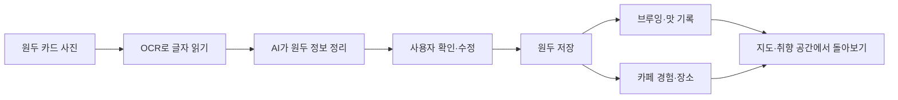

# BLANK

**원두 카드 사진 한 장에서 시작해, 나의 커피 경험과 취향을 기록하는 서비스입니다.**

커피를 마시고 난 뒤 원두 이름이나 향미를 다시 찾으려면 포장지와 사진, 메모를 따로 확인해야 합니다. 원두 카드에 적힌 생산지·품종·가공 방식까지 직접 옮겨 적으려면 기록을 시작하는 데에도 많은 입력이 필요합니다.

BLANK는 이 입력 부담을 줄이고, 흩어진 원두 정보와 브루잉·카페 경험을 연결하기 위해 만들고 있습니다. AI가 사진에서 읽은 내용을 등록 폼의 초안으로 정리하고, 사용자가 확인한 정보를 자신의 기록으로 쌓는 것이 서비스의 출발점입니다.

## 만들고자 하는 경험

| 목표 | 서비스에서의 접근 |
| --- | --- |
| 기록을 쉽게 시작하기 | 사진으로 원두 정보를 읽고 AI가 입력 폼 초안 작성 |
| 기록의 정확성을 사용자가 확인하기 | AI 결과를 바로 저장하지 않고 수정·확인 후 저장 |
| 부담 없이 기록을 이어가기 | 필수 정보와 선택 정보를 나누고 단계별 입력 제공 |
| 커피 경험을 연결하기 | 원두에 브루잉 기록, 맛 프로필, 구매처와 카페 경험 연결 |
| 쌓인 기록에서 취향 발견하기 | 향미 그라데이션, 원산지 지도, 3D 취향 공간으로 표현 |

AI의 역할은 사용자의 취향을 대신 결정하는 것이 아니라 **입력을 돕고, 기록을 이해하기 쉬운 형태로 연결하는 것**입니다. 재고 계산과 사용자별 데이터 접근 같은 서비스 규칙은 백엔드가 처리합니다.

## 주요 사용자 흐름

- **원두 관리**: 사진 등록, 원두 상세, 향미, 구매 정보, 보유·소진 상태 관리
- **브루잉 기록**: HOT/ICE, 추출 조건, 푸어링, 6축 맛 프로필과 만족도 기록
- **카페 경험**: 방문 장소와 마신 커피의 맛·느낌 기록
- **기록 탐색**: 원산지 세계지도, 카페 지도, 향미 기반 시각 표현과 취향 공간

## 구현에서 중요하게 생각한 점

프론트는 실제 입력 흐름이 복잡해지지 않도록 구성했습니다. AI 처리 중에는 선택한 사진과 현재 단계를 보여주고, 결과 확인 뒤 선택 정보를 이어서 작성할 수 있습니다. 화면 크기에 따라 배치를 조정하며 지도와 3D 같은 브라우저 기능은 SSR 화면과 분리합니다.

백엔드는 기록의 일관성과 AI 결과의 추적 가능성에 집중했습니다. OCR, LLM, 검증, 폼 변환을 나누고 단계별 값을 로그에 남깁니다. AI 결과는 수정 가능한 후보이며 저장 명령과 분리되어 있습니다. 브루잉의 재고 차감·복원과 사용자별 접근 범위는 서비스 계층에서 관리합니다.

## 서비스 아키텍처

[SVG 원본](docs/architecture/blank-service-architecture.svg) · [PNG 이미지](docs/architecture/blank-service-architecture.png) · [백엔드 상세 설명](coffee/README.md#아키텍처)

## 프로젝트 구성과 상세 문서

| 위치 | 역할 | 문서 |
| --- | --- | --- |
| `front/` | Vue 3 + Nuxt SSR 프론트 | [프론트 구현 원칙과 구조](front/README.md) |
| `coffee/` | Spring Boot 백엔드 | [아키텍처·AI 도입과 활용](coffee/README.md) |
| `sh/` | 로컬 개발 서버 실행 | [스크립트 사용법](sh/README.md) |
| `logs/` | 로컬 OCR·LLM 분석 로그 | [로그 읽는 방법](logs/README.md) |

**처음 실행한다면 [SETUP.md](SETUP.md)를 먼저 확인하세요.** clone 후 추가할 로컬 설정 파일, API 키 발급 사이트, DB·OCR 준비와 실행 순서를 정리했습니다.

현재 원두 OCR 텍스트 파싱과 향미 색상 추천에는 **Groq API의 Qwen 3.8 27B**를 사용합니다. 취향 임베딩은 별도 OpenRouter 경로를 사용하며 자세한 구성은 백엔드 문서에 설명합니다.

## 현재 개발 상태

개인 커피 기록의 입력·조회와 AI 보조 흐름을 구현하고 개선 중입니다. 취향 공간은 기록을 탐색하는 시각화이며, 추천 정확도를 검증한 추천 시스템으로 보지는 않습니다. 원두 카드의 글자 크기와 로고 형태에 따라 인식 결과가 달라질 수 있어 사용자 확인을 유지합니다.

[brewing-coffee 저장소](https://github.com/Seonggyun01/brewing-coffee)에 프론트·백엔드·실행 스크립트를 함께 관리합니다. 한 번 clone하면 전체 프로젝트 코드를 받을 수 있으며, 개인 API 키와 DB 설정만 별도로 준비합니다.
