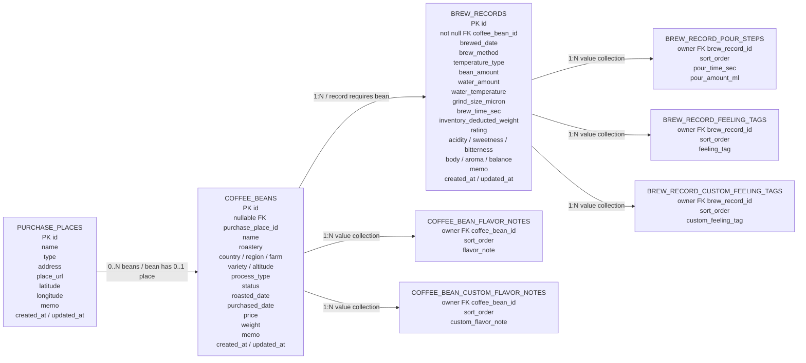

# BLANK

BLANK는 커피 원두, 브루잉 레시피, 맛 기록, 원산지와 카페 방문 지도를 함께 관리하는 개인용 웹 애플리케이션입니다. 현재는 원두 관리, 브루잉 기록, 원산지 세계 지도, 카페 지도 흐름을 중심으로 구현하고 있으며, 브루잉에 사용한 원두의 재고 차감까지 연결되어 있습니다.

## 기술 스택

| 구분 | 기술 |
| --- | --- |
| Language | Java 21 |
| Framework | Spring Boot 4.0.6 |
| View | Thymeleaf |
| Persistence | Spring Data JPA |
| Database | MySQL |
| Validation | Bean Validation |
| OCR | PaddleOCR 3.7 / PP-OCRv5 (우선), Google Cloud Vision (fallback) |
| LLM (로컬 원두 OCR 파싱) | Groq API / Qwen 3.8 27B |
| Image Conversion | Openize.HEIC |
| Build | Gradle |
| Utility | Lombok |

## 현재 진행 상황

### 원두 관리

- 원두 목록, 등록, 상세 조회, 수정, 삭제
- 원두 이름 검색
- 원두 목록 카드형 UI 적용
- 원두 상태 구분: 보유 중, 소진 기록, 카페 음용
- 원산지, 농장, 품종, 가공 방식, 고도, 로스팅일, 구매일, 가격, 남은 무게 기록
- 등록 폼은 기본 정보, 상세 정보, 부가 정보로 나누어 입력 부담을 낮춤
- 기본 정보는 원두명, 산지 국가, 품종, 가공 방식, 향미 노트, 메모 중심으로 구성
- 상세 정보는 로스터리, 지역, 농장/워싱스테이션, 고도, 로스팅일처럼 선택 입력 중심으로 구성
- 부가 정보는 남은 무게, 가격, 구매일, 구매처처럼 구매/재고 맥락의 정보로 분리
- 카페에서 마신 원두는 구매/재고 정보 없이도 저장할 수 있도록 부가 정보는 선택 입력으로 유지
- 원두 목록에서 카페 원두 등록 진입을 제공하며, 해당 흐름은 내부 상태를 `CAFE`로 저장
- 원두 분쇄도는 브루잉 기록에서 마이크론미터 단위로 입력
- 원두 향미 노트 저장
- 정해진 향미 노트 선택과 사용자 직접 입력 향미 노트 저장
- 선택한 향미 노트를 별도 영역에 표시해 선택 상태를 인지할 수 있도록 개선
- 구매처 선택 또는 신규 구매처 입력 후 원두와 연결
- 카카오맵 장소 검색 또는 지도 클릭으로 구매처 이름, 주소, 장소 링크, 위도, 경도 자동 입력
- 구매처 장소 링크는 카카오맵뿐 아니라 네이버지도, 구글맵, 온라인 구매 링크까지 담을 수 있도록 범용 `placeUrl`로 저장
- 원두 카드 이미지 업로드 후 OCR 결과를 등록 폼 후보값으로 자동 반영
- JPG, PNG, WEBP, HEIC, HEIF 이미지 업로드 지원
- HEIC/HEIF 이미지는 서버에서 PNG로 변환한 뒤 PaddleOCR에 우선 전달
- OCR 결과는 자동 저장하지 않고 사용자가 확인한 뒤 최종 저장

### 브루잉 기록

- 브루잉 기록 목록, 등록, 상세 조회, 수정, 삭제
- 원두 선택 후 브루잉 기록 작성
- 브루잉 방식, HOT/ICE, 원두량, 물량, 물 온도, 분쇄도, 총 추출 시간 기록
- 맛 점수 6축 기록: 산미, 단맛, 쓴맛, 바디감, 향, 밸런스
- 상세 화면에서 맛 점수를 6각형 차트로 시각화
- 감정/느낌 태그 선택과 사용자 직접 입력 태그 저장
- 선택한 태그를 별도 영역에 표시해 선택 상태를 인지할 수 있도록 개선
- 푸어링 타임라인 입력
- 기본 종료 시간 3분, 사용자가 입력한 종료 시간을 타임라인 끝으로 사용
- 푸어링 카드는 드래그 앤 드랍으로 순서와 시작 시간을 조정
- 드래그 앤 드랍은 5초 단위로 보정
- 상세 화면에서 푸어링 레시피를 시간-물량 그래프로 표시
- 누적 물량 곡선 그래프로 레시피 흐름을 더 쉽게 볼 수 있도록 개선
- 브루잉에 사용한 원두가 보유 중인 원두라면 사용량만큼 남은 무게 자동 차감
- 브루잉 기록 수정/삭제 시 기존 차감량을 복원한 뒤 새 차감량을 반영

### 공통 및 개발 환경

- 루트 페이지를 원산지 세계 지도 메인 화면으로 제공
- 서버 실행 시 개발용 더미 데이터 생성
- MySQL 기반 로컬 데이터 영속화
- 주요 서비스/컨트롤러 흐름 테스트
- 기본 실행은 로컬 PaddleOCR을 사용하며, 로컬 추출 실패 시에만 Google Vision OCR을 사용
- Google Vision OCR은 `application-local.yml`의 서비스 계정 경로 또는 `GOOGLE_APPLICATION_CREDENTIALS`로 인증
- 테스트 환경에서는 `mock` provider를 사용

### 원산지 세계 지도

- `/`에서 경험한 원두의 원산지를 세계 지도에 표시
- 경험한 원두 수에 따라 국가 색상 단계 적용
- 국가 클릭 시 선택 국가 패널 표시
- 선택 국가 패널에서 경험 원두 수, 브루잉 기록 수, 최근 원두 목록 확인
- 최근 원두 카드에 향미 노트 기반 그라데이션 표시
- 국가별 원두 보기 버튼으로 원두 목록을 국가 필터 상태로 이동
- 작은 국가도 확인할 수 있도록 확대/축소 지원
- 확대 후 드래그로 지도 이동 가능
- 마우스 휠 확대 속도를 낮춰 세밀하게 조작 가능

### 카페 지도

- `/cafes/map`에서 방문 또는 기록한 카페를 카카오맵에 표시
- 좌표가 있는 카페 필터커피 기록과 카페 유형 구매처를 지도 마커로 표시
- 지도 마커 또는 우측 카페 목록을 선택하면 선택 카페 정보를 표시
- 전체 지도 버튼으로 전국 범위 화면으로 복귀
- 현재 지도 화면 안의 주변 카페를 카카오 장소 검색으로 조회하고 임시 핀으로 표시
- 카페 필터커피 등록/수정 화면에서 카카오맵 장소 검색 또는 지도 클릭으로 카페 정보를 자동 입력

## 현재 ERD

아래 ERD는 현재 JPA 매핑 기준입니다. `CoffeeBean`, `BrewRecord`, `PurchasePlace`만 독립 엔티티이고, 향미 노트, 느낌 태그, 푸어링 단계는 `@ElementCollection` 값 컬렉션으로 별도 테이블에 저장됩니다.



## 프로젝트 구조

```text
coffee_project
├── README.md
└── coffee
    ├── build.gradle
    └── src
        ├── main
        │   ├── java/com/hsg/coffee
        │   │   ├── CoffeeApplication.java
        │   │   ├── domain
        │   │   │   ├── brewRecord
        │   │   │   │   ├── controller
        │   │   │   │   ├── dto
        │   │   │   │   ├── entity
        │   │   │   │   ├── repository
        │   │   │   │   └── service
        │   │   │   ├── coffeeBean
        │   │   │   │   ├── controller
        │   │   │   │   ├── dto
        │   │   │   │   ├── entity
        │   │   │   │   ├── repository
        │   │   │   │   └── service
        │   │   │   ├── cafeMap
        │   │   │   │   ├── controller
        │   │   │   │   ├── dto
        │   │   │   │   └── service
        │   │   │   ├── dashboard
        │   │   │   ├── originMap
        │   │   │   │   ├── controller
        │   │   │   │   ├── dto
        │   │   │   │   ├── entity
        │   │   │   │   └── service
        │   │   │   └── purchasePlace
        │   │   │       ├── entity
        │   │   │       ├── repository
        │   │   │       └── service
        │   │   └── global
        │   │       ├── config
        │   │       └── entity
        │   └── resources
        │       ├── application.yml
        │       ├── static/css
        │       ├── static/data
        │       ├── static/js
        │       └── templates
        └── test
```

## 실행 방법

Java 21이 필요합니다.

새 PC에서 MySQL, PaddleOCR, Ollama, 로컬 비밀 설정까지 처음 준비하는 경우 [로컬 실행 준비 가이드](docs/LOCAL_SETUP_GUIDE.md)를 먼저 확인합니다.

```bash
java -version
```

애플리케이션 실행:

```bash
cd coffee
./gradlew bootRun
```

브라우저 접속:

```text
http://localhost:8080
```

주요 화면:

```text
http://localhost:8080/
http://localhost:8080/coffee-beans
http://localhost:8080/brew-records
http://localhost:8080/cafes/map
```

### 원두 카드 OCR → LLM 파싱 설정

현재 로컬 환경의 LLM 공급자는 **Groq**, 모델은 **Qwen 3.8 27B** (`qwen/qwen3.8-27b`)입니다.
이미지에서 읽은 OCR 텍스트를 Groq로 보내 원두 등록 JSON 후보를 만들고, 서버 검증을 거쳐 폼에 표시합니다. 사용자가 확인하기 전에는 DB에 저장하지 않습니다.

| 항목 | 설정 |
| --- | --- |
| API 제공 사이트 | [Groq Console](https://console.groq.com/) |
| API 키 발급 | [Groq API Keys](https://console.groq.com/keys) |
| 모델 | [Qwen 3.8 27B](https://console.groq.com/docs/model/qwen/qwen3.8-27b) / `qwen/qwen3.8-27b` |
| 요청 주소 | `https://api.groq.com/openai/v1/chat/completions` |
| 추론 | `reasoning_effort: none` |
| 기본 최대 출력 | **768토큰** (`BREWLOG_GROQ_MAX_TOKENS`로 조정) |
| temperature / timeout | `0.0` / `60초` |
| 로컬 비밀 설정 | `coffee/src/main/resources/application-local.yml`의 `brewlog.llm.groq.api-key` |

Groq에서 발급한 키를 사용합니다. OpenRouter 키나 Google Vision 인증 키와는 별개입니다.
실제 API 키는 README·프론트 코드·Git에 넣지 않습니다. 로컬 비밀 설정 대신 환경변수로도 전달할 수 있습니다.

```bash
export GROQ_API_KEY='발급받은_Groq_API_키'
export BREWLOG_LLM_PROVIDER=groq
export BREWLOG_GROQ_MAX_TOKENS=768
```

로컬 YAML 설정 형태는 다음과 같습니다. 환경변수를 사용하려면 기존에 직접 적은 키 대신 아래 참조를 사용합니다.

```yaml
brewlog:
  llm:
    provider: groq
    groq:
      api-key: ${GROQ_API_KEY:}
      model-id: qwen/qwen3.8-27b
      max-tokens: 768
```

프롬프트와 필드 검증은 기존 로직을 재사용합니다. 빈 응답·출력 잘림·API 실패 시 오류를 안내하며 OCR 추측값만으로 폼을 채우지 않습니다.
키·모델·출력 한도를 바꾸면 백엔드를 재시작해야 합니다.

#### 최근 실제 요청의 토큰 사용량

2026-10-19 한국 시간 기준, `logs/bean-extraction.jsonl`에 기록된 Groq 실제 요청 **2건**입니다. 테스트용 Mock 요청과 다른 공급자의 비교 호출은 제외했습니다.

| 요청 시각 (KST) | 입력 토큰 | 출력 토큰 | 합계 | OCR | LLM·검증 | 전체 |
| --- | ---: | ---: | ---: | ---: | ---: | ---: |
| 21:03 | 1,227 | 223 | 1,450 | 7.290초 | 1.964초 | 9.278초 |
| 21:05 | 1,209 | 222 | 1,431 | 6.516초 | 0.978초 | 7.513초 |
| 평균 | 1,218 | 222.5 | 1,440.5 | 6.903초 | 1.471초 | 8.396초 |

두 요청 모두 HTTP 200 / `finish_reason=stop`으로 JSON을 정상 반환했습니다.
관측된 최대 출력은 223토큰이므로 기본 출력 상한을 2,048에서 768로 낮췄습니다. 이는 관측 최대의 약 3.4배로, 더 긴 이름·상세 정보·향미를 위한 여유를 둔 값입니다.
`max_tokens`는 출력의 상한이며 매번 768토큰을 소비한다는 뜻이 아닙니다. 입력 프롬프트와 OCR 텍스트의 토큰 수는 이 상한과 별도입니다.
표본이 2건뿐이므로 긴 카드나 복수 원두의 사용량까지 대표하지 않습니다.

#### Groq 무료 한도

[공식 Rate Limits](https://console.groq.com/docs/rate-limits)의 `qwen/qwen3.8-27b` 무료 플랜 표를 2026-10-19에 확인했습니다.

| 제한 | 공개 무료 한도 |
| --- | ---: |
| 분당 요청 수 (RPM) | 30회 |
| 일일 요청 수 (RPD) | 1,000회 |
| 분당 토큰 수 (TPM) | 8,000토큰 |
| 일일 토큰 수 (TPD) | 200,000토큰 |

요청 횟수와 토큰 제한이 동시에 적용되며 먼저 도달한 한도에 의해 제한됩니다. 한도는 조직 단위이며 실제 계정의 [Limits 화면](https://console.groq.com/settings/limits)이 우선합니다. 캐시 토큰은 공식 안내상 제한 계산에서 제외됩니다.
이번 평균 1,440.5토큰/건을 단순 적용하면 토큰 예산상 **분당 약 5건, 하루 약 138건** 수준입니다. 이는 처리량 보장이나 현재 계정의 잔여량이 아니라 캐시·다른 API 사용·실제 입력 길이를 제외한 대략적인 계산입니다.
따라서 하루 1,000회 요청 한도가 있어도 현재 프롬프트 길이에서는 토큰 한도가 먼저 걸릴 수 있습니다.

`logs/bean-extraction.jsonl`의 같은 `requestId`로 `ocr.result`, `llm.request.settings`, `llm.http.response`, `llm.validated`, `form.result`를 연결할 수 있습니다.
Groq 원본 응답의 `usage.prompt_tokens`, `usage.completion_tokens`, `usage.total_tokens`에서 실사용 토큰을 확인합니다.

### 서버용 외부 AI 설정

`server` 프로필에서는 Google Vision OCR을 사용합니다. 서버에서도 현재 로컬과 같은 Groq 모델을 사용하려면 공급자를 명시합니다.

```bash
export SPRING_PROFILES_ACTIVE=server
export GOOGLE_APPLICATION_CREDENTIALS=/secure/path/google-service-account.json
export BREWLOG_LLM_PROVIDER=groq
export GROQ_API_KEY='발급받은_Groq_API_키'
export BREWLOG_GROQ_MAX_TOKENS=768
```

공급자를 명시하지 않은 `server` 프로필의 기존 기본값은 OpenRouter입니다. OpenRouter를 선택하는 경우 `OPENROUTER_API_KEY`를 별도로 사용하며, 현재 공통 설정의 기본 모델은 `google/gemma-4-31b-it:free`입니다. 자동 모델 fallback은 사용하지 않습니다.
OCR은 Google Vision만 사용하며 다른 OCR로 fallback하지 않습니다. 기존 서버 배포 절차는 [서버 외부 AI 설정](docs/SERVER_AI_SETUP.md)을 참고하되, 현재 사용할 LLM 공급자와 키는 위 설정을 적용합니다.

## 빌드 및 테스트

```bash
cd coffee
./gradlew clean build
```

테스트는 원두와 브루잉 기록의 레포지토리, 서비스, 컨트롤러 흐름을 확인합니다. 테스트 콘솔 출력은 UTF-8 기준으로 설정되어 있습니다.

## 개발 데이터베이스

기본 실행 환경은 MySQL을 사용합니다. 애플리케이션을 재시작해도 기록이 남도록 JPA 설정은 `ddl-auto: update`로 둡니다. 테스트 환경은 빠른 실행을 위해 `src/test/resources/application.yml`에서 H2 인메모리 DB를 계속 사용합니다.

### MySQL 준비

MySQL 8.x 기준으로 아래 데이터베이스와 계정을 준비합니다.

```sql
CREATE DATABASE brewlog
  DEFAULT CHARACTER SET utf8mb4
  DEFAULT COLLATE utf8mb4_unicode_ci;

CREATE USER 'brewlog'@'localhost' IDENTIFIED BY 'brewlog';
GRANT ALL PRIVILEGES ON brewlog.* TO 'brewlog'@'localhost';
FLUSH PRIVILEGES;
```

기본 접속값은 아래와 같습니다.

| 설정 | 기본값 | 설명 |
| --- | --- | --- |
| `DB_HOST` | `localhost` | MySQL 호스트 |
| `DB_PORT` | `3306` | MySQL 포트 |
| `DB_NAME` | `brewlog` | 사용할 데이터베이스 이름 |
| `DB_USERNAME` | `brewlog` | DB 사용자 |
| `DB_PASSWORD` | `brewlog` | DB 비밀번호 |
| `DB_TIMEZONE` | `Asia/Seoul` | JDBC 서버 타임존 |
| `BREWLOG_DUMMY_DATA_ENABLED` | `false` | 개발용 더미 데이터 자동 생성 여부 |
| `BREWLOG_KAKAO_JAVASCRIPT_KEY` | 없음 | 카카오맵 JavaScript SDK 키 |

다른 계정이나 비밀번호를 쓸 경우 실행 전에 환경변수로 지정합니다.

```bash
export DB_HOST=localhost
export DB_PORT=3306
export DB_NAME=brewlog
export DB_USERNAME=brewlog
export DB_PASSWORD='원하는_비밀번호'
export DB_TIMEZONE=Asia/Seoul
export BREWLOG_KAKAO_JAVASCRIPT_KEY='카카오_JavaScript_키'
```

## 카카오맵 설정

카페 지도와 구매처/카페 자동 입력 기능은 Kakao Maps JavaScript SDK를 사용합니다.

1. Kakao Developers에서 애플리케이션을 만들고 JavaScript 키를 확인합니다.
2. `application-local.yml` 또는 환경변수에 JavaScript 키를 설정합니다.
3. Kakao Developers의 JavaScript SDK 도메인에 실제 접속 주소를 등록합니다.

로컬 PC에서만 접속한다면 아래 주소를 등록합니다.

```text
http://localhost:8080
```

아이패드나 다른 기기에서 같은 와이파이로 접속한다면 맥북의 현재 IP와 포트까지 포함해서 등록합니다.

```text
http://192.168.x.x:8080
```

등록할 때는 REST API 키나 Native 앱 키가 아니라 반드시 JavaScript 키를 사용해야 합니다. IP가 바뀌면 Kakao Developers에 등록한 도메인도 함께 바꿔야 합니다.

## 구매처 정책

구매처 정보는 선택 입력입니다.

- 구매처를 남기지 않아도 원두 저장 가능
- 기존에 등록된 구매처가 있으면 선택해서 연결 가능
- 기존 구매처를 선택하지 않고 구매처 이름을 입력하면 이름, 주소, 장소 링크, 좌표 기준으로 기존 구매처를 재사용하거나 새 구매처 생성
- 사용자는 주소를 직접 입력하거나 카카오맵 장소 검색/지도 클릭으로 자동 입력 가능
- 카페 유형 구매처는 위도, 경도가 있으면 카페 지도에 표시
- 카카오맵에서 선택한 구매처는 위도, 경도를 함께 저장해 지도 표시와 중복 방지에 사용

## 다음 구현 스텝: 원두 카드 이미지 자동 입력

`docs/specs/coffee_bean_card_image_extraction_spec_v1.md` 기준으로 원두 정보 카드 이미지를 업로드하면 원두 등록 폼을 자동으로 채워주는 기능을 구현합니다.

핵심 원칙:

- 사진 업로드 결과는 바로 DB에 저장하지 않음
- OCR/파싱 결과는 `CoffeeBeanCreateForm`을 채우는 임시 후보로만 사용
- 최종 저장은 사용자가 확인하고 수정한 뒤 기존 `POST /coffee-beans` 흐름으로만 처리
- 1차 구현은 실제 OCR 연동 전 Mock OCR로 전체 흐름을 먼저 검증
- MVP에서는 업로드 이미지를 저장하지 않고 텍스트 추출 결과만 화면에 표시

구현 순서:

1. DTO와 인터페이스 추가
   - `CoffeeBeanCardExtractResult`
   - `CoffeeBeanCardTextParseResult`
   - `CoffeeBeanCardOcrService`

2. Mock OCR 기반 추출 흐름 추가
   - `MockCoffeeBeanCardOcrService`
   - `CoffeeBeanCardExtractionService`
   - `CoffeeBeanCardTextParser` 기본 구조
   - 이미지 파일 유효성 검증: 빈 파일, 이미지 타입, 5MB 제한

3. 원두 등록 컨트롤러 연동
   - `POST /coffee-beans/card-extraction` 추가
   - 업로드 이미지를 OCR/파싱 처리한 뒤 기존 원두 등록 폼으로 재렌더링
   - 원두 등록 폼 옵션 데이터를 공통 메서드로 분리
   - 해당 URL에서는 DB 저장을 하지 않도록 보장

4. 원두 등록 화면 UI 추가
   - `coffee-beans/form.html` 상단에 사진 업로드 영역 추가
   - 추출된 rawText 표시 영역 추가
   - 추출 실패 또는 일부 누락 경고 메시지 표시
   - 자동 입력된 값은 사용자가 직접 수정 가능하게 유지

5. 규칙 기반 텍스트 파서 구현
   - 가공 방식, 용량, 가격, 로스팅 날짜 추출
   - 국가 코드와 국가명 매핑
   - 향미 노트 enum 및 사용자 입력 향미 후보 매핑
   - 원두명과 로스터리 후보 추출
   - 불확실하거나 실패한 항목은 warning으로 반환

6. 테스트와 수동 검증
   - 파서 단위 테스트
   - 추출 서비스 테스트
   - `POST /coffee-beans/card-extraction` 컨트롤러 테스트
   - 업로드 후 자동 입력, 수정, 기존 등록 저장 흐름 수동 확인

7. 실제 OCR 연동 확장
   - 로컬 PaddleOCR을 기본 OCR 구현체로 사용
   - 로컬 추출 실패 또는 결과 부족 시 Google Vision OCR로 fallback
   - `CoffeeBeanCardOcrService` 인터페이스를 통해 테스트용 Mock 구현체와 분리

8. 이후 LLM 구조화 확장
   - OCR rawText를 JSON 후보로 구조화
   - 확실하지 않은 값은 `null` 또는 warning으로 처리
   - 웹은 Thymeleaf 폼 재렌더링, 앱은 `POST /api/coffee-beans/card-extraction`로 확장

## 개발 로드맵

1. 원두 목록과 브루잉 목록의 디자인 일관성 추가 개선
2. 원두 카드 이미지 기반 자동 입력 MVP 구현
3. 구매처 관리 화면 분리
4. 카페 지도 검색 결과와 방문 카페 목록의 필터/정렬 개선
5. 카페 음용 원두와 구매 원두의 입력 흐름 분리
6. 브루잉 기록 카드 디자인을 노트형 UI로 개선
7. 브루잉 기록 기반 통계 대시보드
8. 원두와 브루잉 기록 검색, 필터, 정렬 개선
9. 파일 기반 DB 또는 운영 DB 전환
