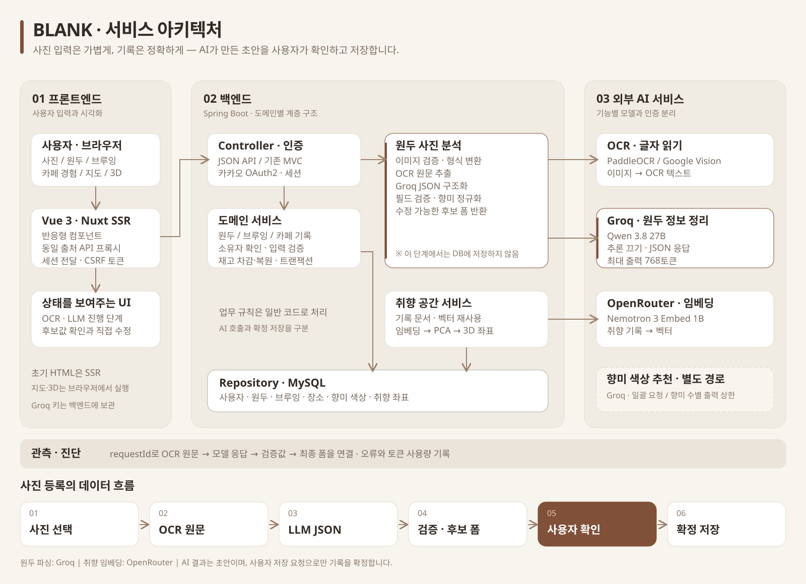
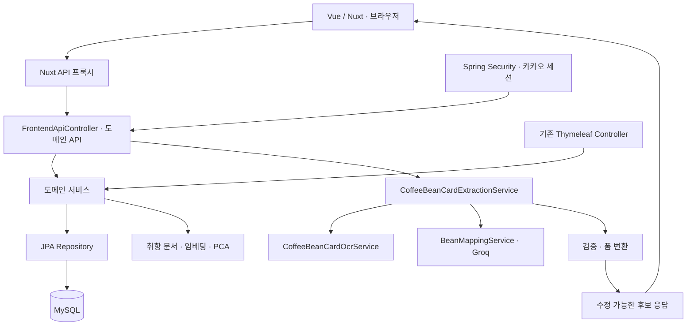
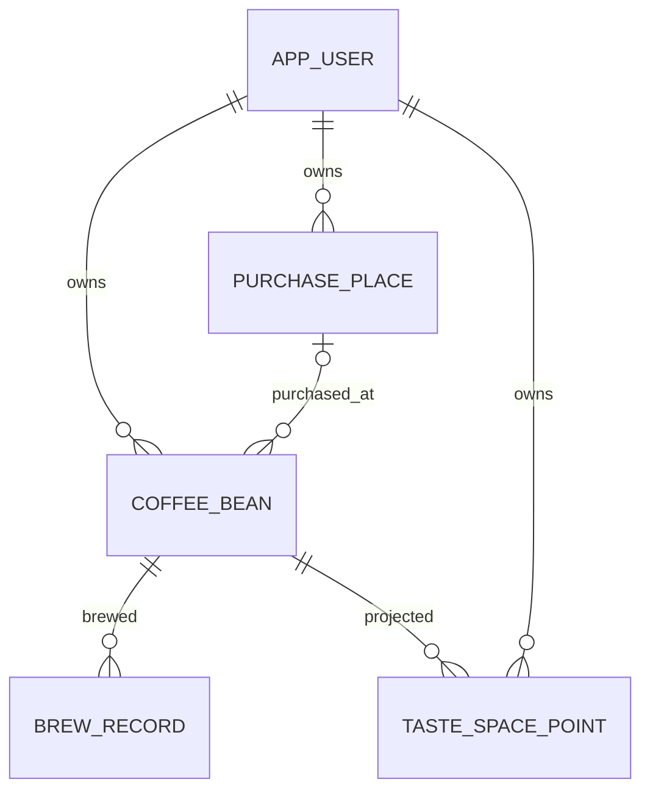
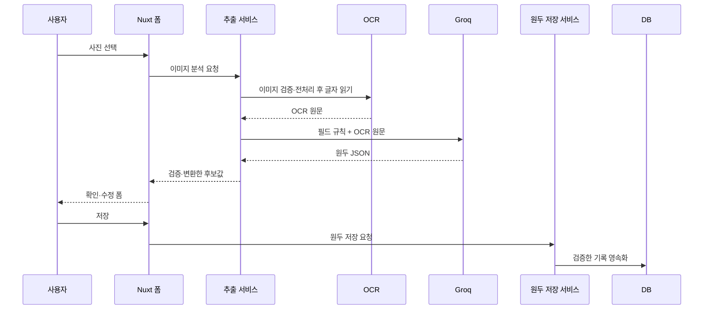

# BLANK · 백엔드

**커피 기록의 일관성을 관리하고, AI가 읽은 원두 정보를 사용자가 확인할 수 있는 데이터로 연결하는 Spring Boot 서버입니다.**

원두 카드에는 생산 국가, 산지, 농장, 품종, 가공 방식과 향미가 서로 다른 순서·줄바꿈·언어로 적혀 있습니다. 단순 CRUD를 제공하는 것에 더해, 이 정보를 직접 옮겨 적는 부담을 줄이면서도 잘못 인식한 값이 그대로 저장되지 않도록 만드는 것이 백엔드의 주요 목표입니다.

이 문서는 통합 저장소의 백엔드 구조와 구현을 설명합니다. 프로젝트 전체 목적은 [최상위 README](../README.md), 새 PC에서 추가할 비밀 설정과 실행 준비는 [SETUP.md](../SETUP.md)를 참고합니다. 같은 저장소에 프론트와 실행 스크립트가 포함되어 있습니다.

## 설계 목표

| 목표 | 구현 방향 |
| --- | --- |
| AI 입력과 확정 데이터 구분 | 사진 분석은 후보 폼만 반환하고 사용자 저장 요청에서 영속화 |
| 사용자 기록의 일관성 | 브루잉 저장·수정·삭제와 원두 재고 변경을 트랜잭션으로 처리 |
| AI 장애의 원인 추적 | OCR 원문, 모델 설정, 원본 응답, 검증값, 최종 폼을 요청 ID로 연결 |
| 외부 모델 변경에 대응 | OCR·LLM 역할을 인터페이스로 나누고 공급자별 구현 선택 |
| 기존 서비스 재사용 | Nuxt용 JSON API와 기존 MVC 화면이 같은 도메인 서비스를 사용 |
| 기록의 확장된 활용 | 향미 색상과 임베딩 기반 취향 공간에 저장된 기록을 활용 |

## 기술 구성

| 영역 | 기술·역할 |
| --- | --- |
| 언어 / 프레임워크 | Java 21 / Spring Boot 4.0.6, Spring MVC |
| 데이터 저장 | Spring Data JPA / MySQL, 테스트는 H2 |
| 인증 | Spring Security OAuth2 Client / 카카오 로그인 / 세션 |
| 입력 검증 | Bean Validation, Form·DTO 및 서비스 검증 |
| 기존 UI | Thymeleaf, 이전 자원은 `legacy-front/`에서 재사용 |
| 이미지 전처리 | Openize.HEIC를 이용한 HEIC/HEIF 변환 |
| OCR | 로컬 PaddleOCR / 선택적으로 Google Cloud Vision |
| 원두 구조화 | Groq API / `qwen/qwen3.8-27b` |
| 취향 공간 | OpenRouter Embeddings + Apache Commons Math 기반 PCA |
| 상태·진단 | SSE 진행 단계, Logback JSONL 추출 로그 |
| 빌드 | Gradle Wrapper, JUnit·Spring 테스트 |

## 아키텍처



[SVG 원본](../docs/architecture/blank-service-architecture.svg) · [PNG 이미지](../docs/architecture/blank-service-architecture.png)

도메인별 패키지를 가진 단일 Spring 애플리케이션입니다. Controller는 요청과 응답, Service는 업무 흐름과 트랜잭션, Repository는 DB 접근을 담당합니다. 외부 OCR·LLM·임베딩 요청은 전용 서비스 또는 클라이언트로 분리합니다.



사진 분석과 원두 생성은 별도의 요청입니다. AI가 JSON을 반환했다고 해서 Repository 저장이 바로 실행되지 않습니다. 사용자 확인 후 기존 원두 생성·수정 서비스를 호출합니다.

### 패키지별 책임

| 패키지 | 책임 |
| --- | --- |
| `domain.coffeeBean` | 원두·재고·향미, 사진 추출과 후보 폼 변환 |
| `domain.brewRecord` | 브루잉 조건·맛 평가·푸어링·재고 차감/복원 |
| `domain.cafeFilterCoffee` | 카페에서 마신 커피와 장소·맛 기록 |
| `domain.purchasePlace` | 구매처와 카페 위치·주소·장소 링크 |
| `domain.originMap`, `domain.cafeMap` | 사용자 기록을 지도 표시용 데이터로 집계 |
| `domain.llmparsing` | OCR 전처리, 프롬프트, 공급자 호출, JSON 검증 |
| `domain.tasteSpace` | 취향 문서 생성, 임베딩 캐시, 3D 투영과 조회 |
| `domain.frontend` | 새 프론트용 JSON API, 폼 옵션과 오류 응답 |
| `domain.user`, `global.security` | 사용자, OAuth 로그인, 현재 사용자와 접근 범위 |
| `global.logging` | 추출 요청 ID와 단계별 분석 로그 |

## 데이터 모델과 서비스 규칙



- `CoffeeBean`: 원두 생산 정보, 향미 목록, 상태와 재고, 선택 구매처를 보유합니다.
- `BrewRecord`: 선택 원두와 추출 조건, 맛 점수, 만족도·메모, 푸어링 정보를 보유합니다.
- `PurchasePlace`: 장소 이름·주소·링크·좌표를 저장해 원두 및 카페 지도에 활용합니다.
- `CustomFlavorNote`: 직접 입력한 향미의 정규화 이름과 표시 색상을 관리하는 별도 엔티티입니다.
- `TasteSpacePoint`: 소유자·원두와 연결된 임베딩, 모델명, 원문 해시와 3D 좌표를 저장합니다.

기본 향미, 직접 입력 향미 이름, 느낌 태그와 푸어링 같은 값 목록은 JPA 값 컬렉션으로 저장합니다. 사용자 정의 향미의 색상 카탈로그는 원두별 향미 이름 목록과 구분합니다.

### 사용자별 접근

인증된 사용자의 ID를 기준으로 원두·구매처·관련 기록을 조회합니다. ID로 개별 원두나 브루잉을 찾을 때에도 소유자 조건을 사용합니다. 인증을 끈 개발·테스트 모드는 별도 경로이므로 운영의 사용자별 접근 보장과 혼동하지 않아야 합니다.

### 브루잉과 재고의 일관성

브루잉 생성 시 사용한 원두량에 맞춰 재고를 차감하고 실제 차감량을 기록합니다. 수정 시에는 이전 원두의 차감량을 복원한 뒤 새 조건을 적용하며, 삭제 시에도 기존 차감량을 복원합니다. 기록 저장과 재고 변경은 서비스 트랜잭션 안에서 처리합니다.

카페 경험은 `CAFE` 상태 원두와 맛 기록으로 연결하며 보유 원두의 재고 관리와 구분합니다. 새 프론트의 카페 입력 API는 레시피 기록을 끈 상태로 서비스를 호출합니다.

핵심 구현: [CoffeeBeanService](src/main/java/com/hsg/coffee/domain/coffeeBean/service/CoffeeBeanService.java), [BrewRecordService](src/main/java/com/hsg/coffee/domain/brewRecord/service/BrewRecordService.java), [CafeFilterCoffeeService](src/main/java/com/hsg/coffee/domain/cafeFilterCoffee/service/CafeFilterCoffeeService.java)

## AI를 도입한 이유와 활용 범위

AI는 자연어로 적힌 카드 내용을 구조화하고, 커피 기록을 시각적으로 탐색할 재료를 만드는 데 사용합니다. 사용자 인증, 재고 계산, 가격·구매일의 확정과 DB 저장 같은 업무 규칙은 일반 코드로 처리합니다.

| 기능 | 도입 목적 | 실제 처리 | 현재 경로 |
| --- | --- | --- | --- |
| 원두 카드 입력 보조 | 생산 정보의 수동 전사와 필드 분류 부담 감소 | 이미지 → OCR → LLM JSON → 검증 → 후보 폼 | **Groq Qwen 3.8 27B** |
| 직접 입력 향미의 색상 | 사전에 없는 향미도 그라데이션으로 표현 | 향미 이름 → 색상 추천 → HEX 검증 → 색상 저장 | Groq 현재 사용 / OpenRouter·Ollama 대체 구현 |
| 취향 공간 | 누적 원두·맛 경험을 유사한 기록끼리 탐색 | 문서 → 임베딩 → PCA 3차원 투영 → 점 저장 | OpenRouter 임베딩 API |

세 기능이 같은 모델이나 키를 사용하는 것은 아닙니다. **현재 원두 파싱과 향미 색상 추천에는 Groq를 사용**하고, 취향 임베딩은 OpenRouter를 사용합니다.

### 1. 원두 카드: OCR과 LLM을 나눈 입력 보조

#### 도입 전의 문제

정규식만으로는 카드마다 다른 줄바꿈과 문맥을 구분하기 어렵습니다. 로스터리 로고가 원두명으로 들어가거나, 쉼표로 나열된 지역명이 향미로 섞이는 문제가 있었습니다. 국가·산지·농장·품종·가공 방식이 합쳐진 원두 상품 제목도 일반 브랜드명과 다르게 해석해야 했습니다.

OCR은 이미지의 글자를 읽는 역할, LLM은 읽힌 텍스트의 문맥을 보고 필드로 나누는 역할로 도입했습니다. 현재 기본 구조화 호출은 이미지를 Groq에 직접 보내는 방식이 아니라 **OCR 텍스트를 보내는 방식**입니다.

#### 처리 순서



1. **이미지 검증·변환**: 빈 파일, 형식·크기 등 업로드 조건을 확인합니다. HEIC/HEIF는 사용 가능한 이미지로 변환합니다. 미리보기 API는 변환 이미지를 반환하며 프론트가 이를 OCR 요청에 재사용할 수 있습니다.
2. **OCR 추출**: `CoffeeBeanCardOcrService`를 통해 Mock·PaddleOCR·Google Vision 구현을 교체합니다. `local-best`의 Vision 대체 처리는 설정으로 켜거나 끕니다.
3. **프롬프트 구성**: 파생된 정규식 후보를 정답처럼 전달하지 않고 OCR 원문과 필드 정의를 보냅니다.
4. **LLM 구조화**: `BeanMappingService`에서 공급자를 선택합니다. Groq는 추론을 끄고 JSON 객체 응답을 요청합니다.
5. **검증·폼 변환**: 응답을 DTO로 파싱하고 허용 필드·값과 향미를 정리합니다. 원두명·로스터리의 불확실한 빈값을 OCR 추측으로 다시 채우지 않습니다. 일부 부가 필드는 기존 규칙 파서를 보조적으로 사용합니다.
6. **사용자 확인**: 후보를 폼에 반영하고 별도의 저장 요청을 기다립니다.

#### 프롬프트에 담은 도메인 규칙

| 필드 | 규칙 |
| --- | --- |
| 원두명 | 명확한 인쇄 제목 우선. 필요하면 확인된 생산국·지역·농장/로트·품종·가공 정보를 연결 |
| 로스터리 | 판매 브랜드와 원두 제목·농장·슬로건을 구분 |
| 국가·지역·농장 | 각각의 역할을 구분하고 라벨·콜론·끝 쉼표 제거 |
| 품종·고도 | 74110 같은 품종 번호를 고도나 향미로 해석하지 않음 |
| 향미 | 실제 감각 표현만 추출. 지역·농장·품종 제외, 복합 향미 보존, 최대 8개 |
| 누락 정보 | 근거가 없으면 빈 문자열 또는 빈 배열. 그럴듯한 내용으로 보완하지 않음 |

정규화한 향미는 정확한 별칭 매칭으로 기본 향미 항목에 연결하고, 목록에 없는 향미는 직접 입력 텍스트로 유지합니다. 단어 일부만 비슷하다는 이유로 다른 향미를 늘리지 않도록 했습니다.

이 규칙은 모델의 정확도를 보장하는 것은 아닙니다. 실제 테스트에서도 깨진 로고가 로스터리로 통과한 사례가 있어, 최종 확인을 사용자에게 남겨둡니다.

#### 실패와 진행 상태

- SSE로 `OCR → LLM → PARSING → COMPLETED / FAILED` 단계를 전달합니다. 진행 상태는 현재 서버 메모리에 보관하므로 서버 재시작·다중 인스턴스에서 공유되는 작업 큐는 아닙니다.
- 공급자가 JSON을 반환하지 않거나 출력 한도로 잘리면 실패로 처리합니다.
- 빈 LLM 결과에서 전체 OCR 추측값을 대신 보여주지 않고 재시도·직접 입력을 안내합니다.
- 새 프론트의 추출 API는 분석 실패를 HTTP 422로 전달합니다. DB 저장과 외부 모델의 자동 재시도는 별도 업무 흐름입니다.
- 무료 모델의 공급자 제한과 일일 한도도 실패 원인이 될 수 있어 응답 상태와 본문을 로그로 구분합니다.

핵심 구현: [추출 서비스](src/main/java/com/hsg/coffee/domain/coffeeBean/service/CoffeeBeanCardExtractionService.java), [프롬프트](src/main/java/com/hsg/coffee/domain/llmparsing/service/BeanMappingPromptFactory.java), [필드 검증](src/main/java/com/hsg/coffee/domain/llmparsing/service/BeanOcrMappingValidator.java), [Groq 클라이언트](src/main/java/com/hsg/coffee/domain/llmparsing/service/GroqChatClient.java)

### 2. 사용자 정의 향미의 색상 추천

기본 향미는 정해진 색상을 사용할 수 있지만, 사용자가 입력한 음료·과일 조합까지 모두 사전에 정의하기는 어렵습니다. 향미 이름에 어울리는 색상을 모델이 제안하도록 하여 목록 카드와 상세의 향미 그라데이션에 활용합니다.

`CustomFlavorNoteService`는 이름을 정규화해 중복을 줄이고, 새 향미의 색상을 저장합니다. 추천 결과는 `#RRGGBB` 형식을 검사하며 모델 실패·유효하지 않은 응답에는 규칙 기반 팔레트를 사용합니다. 저장된 색상은 재사용합니다.

현재 `brewlog.llm.provider=groq`이면 Groq 전용 색상 추천 구현이 우선하며 원두 파싱과 같은 API 키·Qwen 모델을 사용합니다. 추론을 끄고 여러 향미를 `{"colors":{"체리 주스":"#D94B6A","민트":"#72A980"}}` 형태로 한 번에 요청합니다. 향미당 대표 색상은 하나씩 유지합니다. 출력 상한은 **64 + 64 × 요청 향미 수**로 정하며 현재 최대 12개 기준 128~832토큰입니다. OpenRouter 공급자를 선택하면 해당 구현을, 그 외에는 기존 Ollama 구현을 사용할 수 있습니다. API 실패 시에는 다른 모델을 추가 호출하지 않고 로컬 대체 팔레트를 사용합니다.

색상은 새 향미 또는 기본 색상 갱신이 필요한 향미만 모아 **Groq에 1회 일괄 요청**합니다. 예를 들어 새 향미 3개이면 3회가 아니라 1회 호출하고 출력 상한은 256토큰입니다. 기존 저장 색상은 재사용하고 모두 캐시되어 있으면 호출하지 않습니다. 누락되거나 잘못된 색상만 해당 향미의 로컬 팔레트로 대체하며 추가 재요청은 하지 않습니다. 원두 파싱과 색상 요청은 Groq의 같은 요청·토큰 한도를 사용합니다.

핵심 구현: [CustomFlavorNoteService](src/main/java/com/hsg/coffee/domain/coffeeBean/service/CustomFlavorNoteService.java), [색상 추천 인터페이스](src/main/java/com/hsg/coffee/domain/coffeeBean/service/CustomFlavorNoteColorRecommender.java), [대체 팔레트](src/main/java/com/hsg/coffee/domain/coffeeBean/service/FlavorNoteColorFallbackPalette.java)

### 3. 임베딩으로 기록을 연결하는 취향 공간

원두 기록을 단순히 시간순 목록으로 보는 것에서 나아가, 생산 정보와 향미·경험이 비슷한 기록을 공간에서 탐색하기 위해 임베딩을 도입했습니다.

1. `TasteSpaceDocumentBuilder`가 원두명·산지·품종·가공·향미·메모와 관련 브루잉의 평균 만족도·최근 경험을 문서로 만듭니다.
2. 모델 ID와 문서 SHA-256 해시가 기존 저장값과 같으면 임베딩 벡터를 재사용합니다.
3. 바뀐 문서만 OpenRouter 임베딩 API로 보냅니다. 기본 모델은 `nvidia/nemotron-3-embed-1b:free`입니다.
4. `PcaProjectionService`가 벡터를 PCA 기반 3차원 좌표로 투영하고 정규화합니다.
5. 원두별 벡터·해시·좌표를 저장하고, 프론트는 이를 3D 점과 향미 그라데이션으로 렌더링합니다.

조회는 현재 기록과 저장된 점을 비교해 `READY / STALE / EMPTY` 상태를 반환하며, 재생성 요청에서 필요한 임베딩을 갱신합니다. API 키는 Groq 키가 아니라 **OpenRouter 키**를 별도로 사용합니다.

점의 거리는 생산 정보·이름·메모를 포함한 문서의 표현에 영향을 받습니다. 검증된 맛의 거리나 구매 추천 점수는 아닙니다. 기록을 추가해 다시 투영하면 기존 점의 위치도 달라질 수 있습니다.

핵심 구현: [문서 생성](src/main/java/com/hsg/coffee/domain/tasteSpace/service/TasteSpaceDocumentBuilder.java), [벡터 재사용·재생성](src/main/java/com/hsg/coffee/domain/tasteSpace/service/TasteSpaceService.java), [임베딩 호출](src/main/java/com/hsg/coffee/domain/tasteSpace/service/OpenRouterEmbeddingClient.java), [PCA](src/main/java/com/hsg/coffee/domain/tasteSpace/service/PcaProjectionService.java)

## API·인증·프론트 연동

| Spring API | 역할 |
| --- | --- |
| `/api/front/session` | 현재 사용자, CSRF 및 지도 공개 키 조회 |
| `/api/front/beans`, `/api/front/brews`, `/api/front/cafes` | 새 프론트의 기록 조회·등록·수정·삭제 |
| `/api/front/image-preview` | 이미지 변환·미리보기 |
| `/api/front/extraction` | 사진 분석 후보 반환 |
| `/api/coffee-bean-card-extractions/{progressId}/events` | 추출 진행 단계 SSE |
| `/api/taste-space`, `/api/taste-space/rebuild` | 취향 공간 조회·재생성 |

Nuxt는 허용한 API 경로만 프록시하고 Spring 세션 쿠키와 CSRF 흐름을 유지합니다. 폼 DTO는 Bean Validation으로 검사하며 필드 오류를 JSON으로 전달합니다. API 미인증 요청은 401, 기존 HTML 화면은 로그인 이동으로 처리합니다.

카카오 OAuth2 로그인 후 서비스 사용자와 세션을 연결합니다. Nuxt를 경유하는 로그인에서는 실제 프론트 주소의 콜백이 만들어지도록 forwarded 헤더를 사용합니다. 운영에서는 외부 입력 헤더를 그대로 신뢰하지 않도록 프록시 구성이 필요합니다.

## 로그와 실제 사용량 확인

`ExtractionTrace`는 같은 `requestId`로 요청의 각 단계를 JSONL 한 줄씩 기록합니다.

| 단계 | 확인할 내용 |
| --- | --- |
| `request.start` | 파일명·형식·크기 |
| `ocr.result` | 실제 OCR 원문과 경과 시간 |
| `llm.prompt`, `llm.request.settings` | 전달한 필드 규칙·모델·출력 상한·추론 설정 |
| `llm.http.response`, `llm.json` | 공급자 상태 코드, 원본 응답과 토큰 사용량 |
| `llm.validated`, `llm.result` | 검증 후 구조화 데이터 |
| `ocr.fallback.result`, `form.result` | 보조 파서와 최종 폼 사이의 차이 |
| `request.complete`, `request.failed` | 전체 시간 또는 실패 이유 |

예를 들어 향미가 잘못 입력되었다면 OCR에 이미 해당 단어가 있었는지, LLM이 다른 필드에서 가져왔는지, 후처리가 바꿨는지를 구분할 수 있습니다. `ocr.fallback.result`가 있다는 것만으로 전체 LLM 처리가 실패했다는 뜻은 아닙니다.

기본 로그는 상위 `logs/bean-extraction.jsonl`와 `logs/backend.log`에 기록하며 `BREWLOG_TRACE_DIRECTORY`로 위치를 바꿀 수 있습니다. 날짜·크기 기준으로 압축 보관하고 최대 14일을 유지합니다. 실제 OCR 내용과 후보값이 포함되므로 로그는 Git에서 제외합니다. 인증 헤더·이미지 바이트를 로그 값으로 전달하지 않으며 API 키를 문서에 기재하지 않습니다.

## 실행 및 외부 AI 설정

백엔드는 `coffee/`에서 Java 21과 MySQL을 준비한 뒤 실행합니다.

```bash
cd coffee
./gradlew bootRun
```

기본 포트는 8080입니다. 새 프론트와 함께 사용하는 설정 파일 목록은 [최상위 SETUP.md](../SETUP.md), 백엔드 단독의 설치 참고는 [로컬 준비 가이드](../docs/LOCAL_SETUP_GUIDE.md)를 확인합니다. 기존 설치 가이드의 Ollama 항목은 원두 파싱을 Groq로 사용하는 경우 필수가 아니며, 색상 추천도 Groq를 사용하도록 설정되어 있습니다.

### 원두 카드 OCR → LLM 파싱 설정

현재 로컬 환경의 LLM 공급자는 **Groq**, 모델은 **Qwen 3.8 27B** (`qwen/qwen3.8-27b`)입니다.
이미지에서 읽은 OCR 텍스트를 Groq로 보내 원두 등록 JSON 후보를 만들고, 서버 검증을 거쳐 폼에 표시합니다. 사용자가 확인하기 전에는 DB에 저장하지 않습니다.

| 항목 | 설정 |
| --- | --- |
| API 제공 사이트 | [Groq Console](https://console.groq.com/) |
| API 키 발급 | [Groq API Keys](https://console.groq.com/keys) |
| 모델 | [Qwen 3.8 27B](https://console.groq.com/docs/model/qwen/qwen3.8-27b) / `qwen/qwen3.8-27b` |
| 요청 주소 | `https://api.groq.com/openai/v1/chat/completions` |
| 추론 | `reasoning_effort: none` |
| 기본 최대 출력 | **768토큰** (`BREWLOG_GROQ_MAX_TOKENS`로 조정) |
| temperature / timeout | `0.0` / `60초` |
| 로컬 비밀 설정 | `coffee/src/main/resources/application-local.yml`의 `brewlog.llm.groq.api-key` |

Groq에서 발급한 키를 사용합니다. OpenRouter 키나 Google Vision 인증 키와는 별개입니다.
실제 API 키는 README·프론트 코드·Git에 넣지 않습니다. 로컬 비밀 설정 대신 환경변수로도 전달할 수 있습니다.

```bash
export GROQ_API_KEY='발급받은_Groq_API_키'
export BREWLOG_LLM_PROVIDER=groq
export BREWLOG_GROQ_MAX_TOKENS=768
```

로컬 YAML 설정 형태는 다음과 같습니다. 환경변수를 사용하려면 기존에 직접 적은 키 대신 아래 참조를 사용합니다.

```yaml
brewlog:
  llm:
    provider: groq
    groq:
      api-key: ${GROQ_API_KEY:}
      model-id: qwen/qwen3.8-27b
      max-tokens: 768
```

프롬프트와 필드 검증은 기존 로직을 재사용합니다. 빈 응답·출력 잘림·API 실패 시 오류를 안내하며 OCR 추측값만으로 폼을 채우지 않습니다.
키·모델·출력 한도를 바꾸면 백엔드를 재시작해야 합니다.

#### 최근 실제 요청의 토큰 사용량

2026-10-19 한국 시간 기준, `logs/bean-extraction.jsonl`에 기록된 Groq 실제 요청 **2건**입니다. 테스트용 Mock 요청과 다른 공급자의 비교 호출은 제외했습니다.

| 요청 시각 (KST) | 입력 토큰 | 출력 토큰 | 합계 | OCR | LLM·검증 | 전체 |
| --- | ---: | ---: | ---: | ---: | ---: | ---: |
| 21:03 | 1,227 | 223 | 1,450 | 7.290초 | 1.964초 | 9.278초 |
| 21:05 | 1,209 | 222 | 1,431 | 6.516초 | 0.978초 | 7.513초 |
| 평균 | 1,218 | 222.5 | 1,440.5 | 6.903초 | 1.471초 | 8.396초 |

두 요청 모두 HTTP 200 / `finish_reason=stop`으로 JSON을 정상 반환했습니다.
관측된 최대 출력은 223토큰이므로 기본 출력 상한을 2,048에서 768로 낮췄습니다. 이는 관측 최대의 약 3.4배로, 더 긴 이름·상세 정보·향미를 위한 여유를 둔 값입니다.
`max_tokens`는 출력의 상한이며 매번 768토큰을 소비한다는 뜻이 아닙니다. 입력 프롬프트와 OCR 텍스트의 토큰 수는 이 상한과 별도입니다.
표본이 2건뿐이므로 긴 카드나 복수 원두의 사용량까지 대표하지 않습니다.

#### Groq 무료 한도

[공식 Rate Limits](https://console.groq.com/docs/rate-limits)의 `qwen/qwen3.8-27b` 무료 플랜 표를 2026-10-19에 확인했습니다.

| 제한 | 공개 무료 한도 |
| --- | ---: |
| 분당 요청 수 (RPM) | 30회 |
| 일일 요청 수 (RPD) | 1,000회 |
| 분당 토큰 수 (TPM) | 8,000토큰 |
| 일일 토큰 수 (TPD) | 200,000토큰 |

요청 횟수와 토큰 제한이 동시에 적용되며 먼저 도달한 한도에 의해 제한됩니다. 한도는 조직 단위이며 실제 계정의 [Limits 화면](https://console.groq.com/settings/limits)이 우선합니다. 캐시 토큰은 공식 안내상 제한 계산에서 제외됩니다.
이번 평균 1,440.5토큰/건을 단순 적용하면 토큰 예산상 **분당 약 5건, 하루 약 138건** 수준입니다. 이는 처리량 보장이나 현재 계정의 잔여량이 아니라 캐시·다른 API 사용·실제 입력 길이를 제외한 대략적인 계산입니다.
따라서 하루 1,000회 요청 한도가 있어도 현재 프롬프트 길이에서는 토큰 한도가 먼저 걸릴 수 있습니다.

`logs/bean-extraction.jsonl`의 같은 `requestId`로 `ocr.result`, `llm.request.settings`, `llm.http.response`, `llm.validated`, `form.result`를 연결할 수 있습니다.
Groq 원본 응답의 `usage.prompt_tokens`, `usage.completion_tokens`, `usage.total_tokens`에서 실사용 토큰을 확인합니다.

### 서버용 외부 AI 설정

`server` 프로필에서는 Google Vision OCR을 사용합니다. 서버에서도 현재 로컬과 같은 Groq 모델을 사용하려면 공급자를 명시합니다.

```bash
export SPRING_PROFILES_ACTIVE=server
export GOOGLE_APPLICATION_CREDENTIALS=/secure/path/google-service-account.json
export BREWLOG_LLM_PROVIDER=groq
export GROQ_API_KEY='발급받은_Groq_API_키'
export BREWLOG_GROQ_MAX_TOKENS=768
```

공급자를 명시하지 않은 `server` 프로필의 기존 기본값은 OpenRouter입니다. OpenRouter를 선택하는 경우 `OPENROUTER_API_KEY`를 별도로 사용하며, 현재 공통 설정의 기본 모델은 `google/gemma-4-31b-it:free`입니다. 자동 모델 fallback은 사용하지 않습니다.
OCR은 Google Vision만 사용하며 다른 OCR로 fallback하지 않습니다. 기존 서버 배포 절차는 [서버 외부 AI 설정](../docs/SERVER_AI_SETUP.md)을 참고하되, 현재 사용할 LLM 공급자와 키는 위 설정을 적용합니다.


## 개발 데이터베이스

기본 실행 환경은 MySQL을 사용합니다. 애플리케이션을 재시작해도 기록이 남도록 JPA 설정은 `ddl-auto: update`로 둡니다. 테스트 환경은 빠른 실행을 위해 `src/test/resources/application.yml`에서 H2 인메모리 DB를 계속 사용합니다.

### MySQL 준비

MySQL 8.x 기준으로 아래 데이터베이스와 계정을 준비합니다.

```sql
CREATE DATABASE brewlog
  DEFAULT CHARACTER SET utf8mb4
  DEFAULT COLLATE utf8mb4_unicode_ci;

CREATE USER 'brewlog'@'localhost' IDENTIFIED BY 'brewlog';
GRANT ALL PRIVILEGES ON brewlog.* TO 'brewlog'@'localhost';
FLUSH PRIVILEGES;
```

기본 접속값은 아래와 같습니다.

| 설정 | 기본값 | 설명 |
| --- | --- | --- |
| `DB_HOST` | `localhost` | MySQL 호스트 |
| `DB_PORT` | `3306` | MySQL 포트 |
| `DB_NAME` | `brewlog` | 사용할 데이터베이스 이름 |
| `DB_USERNAME` | `brewlog` | DB 사용자 |
| `DB_PASSWORD` | `brewlog` | DB 비밀번호 |
| `DB_TIMEZONE` | `Asia/Seoul` | JDBC 서버 타임존 |
| `BREWLOG_DUMMY_DATA_ENABLED` | `false` | 개발용 더미 데이터 자동 생성 여부 |
| `BREWLOG_KAKAO_JAVASCRIPT_KEY` | 없음 | 카카오맵 JavaScript SDK 키 |

다른 계정이나 비밀번호를 쓸 경우 실행 전에 환경변수로 지정합니다.

```bash
export DB_HOST=localhost
export DB_PORT=3306
export DB_NAME=brewlog
export DB_USERNAME=brewlog
export DB_PASSWORD='원하는_비밀번호'
export DB_TIMEZONE=Asia/Seoul
export BREWLOG_KAKAO_JAVASCRIPT_KEY='카카오_JavaScript_키'
```


## 테스트와 확인 방법

```bash
cd coffee
./gradlew test
./gradlew build
```

| 검증 범위 | 확인하는 내용 |
| --- | --- |
| 원두·브루잉 서비스와 Repository | 기록 저장·조회, 소유자 조건과 재고 처리 |
| 텍스트 파서·LLM 검증 | 필드 분류, 향미 정확 매칭과 불확실한 값 처리 |
| Groq·OpenRouter 클라이언트 | 요청 모델·토큰 상한·추론 설정, 빈 응답·출력 잘림 |
| 공급자 구성 | 설정에 따라 Groq 매핑 구현이 선택되는지 확인 |
| 추출 로그 | 단계가 같은 요청 ID로 연결되고 MDC가 복원되는지 확인 |
| 프론트 API·취향 공간 | 후보 응답·오류 처리, 문서와 좌표 생성 로직 |

테스트 DB는 H2를 사용합니다. 공급자 클라이언트 테스트는 로컬 HTTP 응답이나 Mock을 이용하며 실제 API의 가용성·한국어 정확도까지 보장하지 않습니다. 실제 연동은 카드를 업로드한 뒤 위 추출 로그에서 별도로 확인합니다.

## 현재 한계와 개선 방향

- 깨진 로고나 작은 글자는 OCR과 LLM에서 잘못 읽힐 수 있어 사용자 확인이 필요합니다.
- 무료 API의 제공사 제한은 정상적인 JSON 요청에서도 429로 발생할 수 있습니다.
- 현재 Groq 파싱은 JSON 객체 모드이며 JSON Schema 강제 모드는 적용하지 않았습니다. 응답 DTO와 서버 검증을 함께 사용합니다.
- 진행 상태는 메모리에 저장되어 다중 서버용 작업 관리 체계는 별도 설계가 필요합니다.
- 취향 공간은 탐색용 시각화입니다. 추천 품질이나 실제 맛의 유사성을 평가한 결과는 아직 없습니다.
- 원두 파싱·향미 색상은 Groq 한도를 함께 사용하고 임베딩은 OpenRouter를 사용하므로 기능별 요청량과 장애를 구분해야 합니다.

## 관련 문서

- [프로젝트 소개](../README.md)
- [clone 후 설정 파일과 실행 준비](../SETUP.md)
- [새 프론트의 구현 원칙](../front/README.md)
- [기존 서버 배포 설정](../docs/SERVER_AI_SETUP.md)
