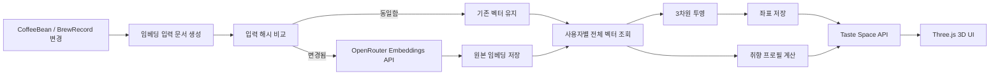

# BLANK 원두 3D 취향 공간 기능 명세서 v1.0

## 1. 문서 목적

이 문서는 사용자가 기록한 원두와 브루잉 경험을 벡터 임베딩으로 표현하고, 이를 3차원 공간에 배치해 탐색하는 **원두 3D 취향 공간** 기능의 구현 명세서이다.

다음 개발에서 이 문서를 기준으로 백엔드, 데이터베이스, 임베딩, 3D UI를 순서대로 구현할 수 있도록 현재 프로젝트 구조에 맞춘 결정과 작업 순서를 함께 기록한다.

핵심 경험은 다음과 같다.

```text
내가 마신 원두들이 하나의 취향 공간을 만든다.
비슷한 경험의 원두는 가까이 모이고, 서로 다른 원두는 멀어진다.
점의 색은 기록해 둔 향미를 은은하게 드러낸다.
공간을 돌려 보거나 점을 선택하면 그 원두의 기억을 다시 볼 수 있다.
아무 점도 선택하지 않았을 때는 지금까지 쌓인 나의 취향을 보여준다.
```

---

## 2. 기능 범위

### 2.1 포함 범위

- 로그인한 사용자의 원두 정보와 브루잉 경험을 임베딩 입력 문서로 변환
- OpenRouter Embeddings API를 통한 벡터 생성
- 임베딩 벡터와 생성 메타데이터 저장
- 고차원 벡터를 사용자별 3차원 좌표로 축소
- 원본 임베딩을 이용한 원두 간 유사도 계산
- Three.js 기반 회전, 확대, 선택이 가능한 3D 공간
- 기존 향미 노트 색상을 사용한 점 표현
- 기본 상태에서 사용자의 선호 원두 특징 요약 표시
- 점 선택 시 오른쪽 패널을 해당 원두 정보로 전환
- 원두 또는 브루잉 기록 변경 시 데이터 갱신
- 데이터 부족, API 실패, WebGL 미지원 상태 처리

### 2.2 초기 범위에서 제외

- 다른 사용자의 취향 공간 공개 및 비교
- 실시간 협업 또는 여러 사용자의 점을 한 공간에 표시
- 3D 좌표 자체를 추천 정확도의 근거로 사용
- 가격, 재고량, 구매일 같은 소비 정보 중심의 임베딩
- 임베딩 모델 학습 또는 파인튜닝
- 대규모 벡터 데이터베이스 도입
- 3D 공간의 각 축에 임의로 `꽃향`, `과일`, `초콜릿` 같은 의미 부여

3D 축소 결과의 X/Y/Z축은 수학적으로 생성된 축이며 고정된 향미 의미를 갖지 않는다. 의미 있는 축이 필요해질 경우 향미 앵커 벡터를 사용하는 별도 기능으로 설계한다.

---

## 3. 현재 프로젝트 기준

이 명세는 현재 코드의 다음 구조를 전제로 한다.

| 영역 | 현재 구조 | 이번 기능에서의 활용 |
|---|---|---|
| 백엔드 | Java 21, Spring Boot 4, Spring MVC | 페이지, API, 임베딩 작업 구현 |
| 화면 | Thymeleaf, Vanilla JavaScript, CSS | 기존 구조를 유지하면서 Three.js만 추가 |
| 데이터 | Spring Data JPA, MySQL, 테스트 H2 | 임베딩과 좌표를 별도 엔티티에 저장 |
| 인증 | Kakao OAuth2, 사용자별 데이터 소유 | 모든 취향 공간 조회와 갱신에 현재 사용자 적용 |
| LLM | OpenRouter Chat Completions 연동 | 취향 요약 문장 생성에 선택적으로 재사용 |
| 향미 | `FlavorNote` 색상, 사용자 정의 향미 색상 | 점의 기본색과 보조색으로 재사용 |
| 원두 | `CoffeeBean.owner` | 임베딩과 좌표의 사용자 경계 |
| 경험 | 원두별 `BrewRecord` | 만족도와 감각 평가를 임베딩 입력에 반영 |

공유 데이터인 향미 노트 이름과 색상은 사용자와 무관하게 재사용한다. 원두, 브루잉 기록, 임베딩, 3D 좌표, 취향 프로필은 모두 사용자별로 격리한다.

---

## 4. 사용자 경험

### 4.1 진입

- 헤더 또는 원두 화면에서 `취향 공간`으로 진입한다.
- URL은 `/taste-space`를 사용한다.
- 서버는 로그인한 사용자의 데이터만 렌더링하거나 API로 반환한다.

### 4.2 기본 상태

3D 공간에는 사용자의 원두가 점으로 표시된다. 오른쪽 패널에는 특정 원두 대신 다음 내용이 표시된다.

- 나의 취향을 나타내는 짧은 제목
- 선호 원두에서 자주 등장한 향미, 가공 방식, 산지
- 높은 만족도를 받은 원두 수와 전체 기록 수
- 취향 중심과 가장 가까운 대표 원두

예시:

```text
꽃 향과 차 같은 질감

높은 만족도를 남긴 원두에서는 자스민, 백도, 홍차 계열이 자주 나타납니다.
워시드 가공과 에티오피아 원두에 대한 선호가 비교적 뚜렷합니다.
```

데이터가 적을 때는 성급하게 취향을 단정하지 않는다.

```text
취향을 알아가는 중

원두와 만족도 기록이 조금 더 쌓이면 자주 좋아하는 향미와 가까운 원두를 보여드릴게요.
```

### 4.3 점 상호작용

- 드래그: 공간 회전
- 휠 또는 핀치: 확대와 축소
- 점 호버: 원두명과 대표 향미를 작은 라벨로 표시
- 점 클릭 또는 탭: 선택 상태 적용 후 오른쪽 패널 갱신
- 빈 공간 클릭 또는 `취향 중심` 버튼: 선택 해제 후 기본 취향 요약으로 복귀
- `원두 기록 보기`: `/coffee-beans/{id}`로 이동

선택된 점은 크기, 외곽 링, 광도 중 두 가지 이상으로 구분한다. 색상만으로 선택 여부를 표현하지 않는다.

### 4.4 반응형 화면

#### 데스크톱

- 왼쪽 3D 공간이 주 화면을 차지한다.
- 오른쪽에 고정 폭의 상세 패널을 둔다.
- 3D 장면은 장식 카드 안에 넣지 않고 화면의 주 작업 영역으로 사용한다.

#### 모바일

- 3D 공간을 상단에 약 `56svh~64svh` 높이로 표시한다.
- 상세 정보는 아래 패널 또는 바텀 시트로 이어진다.
- 핀치, 한 손 드래그, 점 탭이 페이지 스크롤과 충돌하지 않도록 제스처 영역을 분리한다.
- 가장 긴 원두명도 버튼이나 패널 밖으로 넘치지 않게 줄바꿈한다.

---

## 5. 전체 처리 흐름



중요한 원칙은 다음과 같다.

1. 임베딩은 원두 한 건마다 저장한다.
2. 3D 투영은 한 사용자의 원두 집합 전체를 기준으로 계산한다.
3. 유사도와 가장 가까운 원두는 원본 고차원 벡터의 코사인 유사도로 계산한다.
4. 3D 좌표 간 거리는 시각적 탐색에만 사용한다.
5. 외부 API 호출은 DB 트랜잭션 내부에서 수행하지 않는다.

---

## 6. 임베딩 입력 설계

### 6.1 입력에 포함할 데이터

원두의 객관 정보와 사용자의 실제 경험을 함께 사용한다.

| 분류 | 필드 | 처리 방식 |
|---|---|---|
| 식별 정보 | 원두명, 로스터리 | 텍스트 문맥으로 포함 |
| 산지 | 국가, 지역, 농장 | 빈 값 제외 후 포함 |
| 생산 | 품종, 고도, 가공 방식 | 빈 값 제외 후 포함 |
| 향미 | 기본 향미 노트, 사용자 정의 향미 노트 | 정렬된 목록으로 포함 |
| 만족도 | 브루잉 평균 평점, 최고 평점, 평가 횟수 | 집계값으로 포함 |
| 감각 평가 | 산미, 단맛, 쓴맛, 바디, 향, 밸런스 | 기록된 값만 평균 집계 |
| 경험 | 느낌 태그, 사용자 정의 느낌 태그 | 빈도순 목록으로 포함 |
| 메모 | 원두 메모, 브루잉 메모 | 길이 제한 및 정규화 후 포함 |

레시피 수치인 원두량, 물량, 물 온도, 분쇄 설정, 추출 시간은 취향의 의미보다 추출 조건의 영향을 크게 받으므로 초기 임베딩에서는 제외한다. 추후 “레시피 추천 공간”이 필요할 때 별도 임베딩으로 분리한다.

가격, 중량, 구매일, 구매처, 재고 상태도 초기 임베딩에서 제외한다.

### 6.2 정규화된 입력 문서

`EmbeddingDocumentBuilder`가 항상 같은 필드 순서와 표기를 사용해 문서를 만든다.

```text
[원두]
이름: Ethiopia Chelbesa
로스터리: Example Roasters
산지: 에티오피아 / 예가체프 / 첼베사
품종: Heirloom
고도: 1,950-2,200m
가공: 워시드
향미: 자스민, 백도, 홍차

[사용자 경험]
브루잉 기록 수: 4
평균 만족도: 4.5/5
감각 평균: 산미 4.2, 단맛 4.0, 쓴맛 1.3, 바디 2.7, 향 4.6, 밸런스 4.1
느낌: 화사함, 깔끔함, 차 같은 질감
메모 요약: 식으면서 복숭아와 홍차의 인상이 선명해짐
```

문서 생성 규칙:

- `null`, 빈 문자열, 기록되지 않은 평가는 문서에서 제거한다.
- 목록 순서는 저장 순서가 아닌 정규화된 이름 기준으로 고정한다.
- 숫자는 정해진 소수점 자리로 맞춘다.
- 메모의 연속 공백과 줄바꿈을 정리한다.
- 메모는 항목별 최대 길이를 제한한다.
- 개인정보, OAuth 정보, 사용자 식별자는 포함하지 않는다.
- 문서 생성 규칙에 `inputVersion`을 부여한다.
- 완성된 문서의 SHA-256 해시를 저장해 불필요한 재요청을 막는다.

### 6.3 버전 관리

임베딩에는 다음 값이 반드시 함께 저장되어야 한다.

```text
provider
modelId
dimension
inputVersion
inputHash
embeddedAt
```

모델 또는 차원이 다른 벡터끼리는 비교하거나 한 번에 투영하지 않는다. 모델 변경 시 해당 사용자의 원두를 새 버전으로 전체 재생성한다.

---

## 7. OpenRouter 임베딩 연동

### 7.1 API

- Endpoint: `POST https://openrouter.ai/api/v1/embeddings`
- 인증: 기존 OpenRouter API 키를 서버 환경 변수에서 사용
- 입력: 가능하면 여러 원두 문서를 배열로 묶어 배치 요청
- 출력: 원두별 임베딩 배열과 사용량 메타데이터

공식 문서:

- [OpenRouter Embeddings API](https://openrouter.ai/docs/api/api-reference/embeddings/create-embeddings)
- [OpenRouter Models API](https://openrouter.ai/docs/api/api-reference/models/get-models)
- [OpenRouter Embedding Models](https://openrouter.ai/collections/embedding-models/)

### 7.2 설정 예시

키는 저장소에 기록하지 않고 기존과 같이 환경 변수로 주입한다.

```yaml
brewlog:
  embedding:
    provider: ${BREWLOG_EMBEDDING_PROVIDER:openrouter}
    openrouter:
      api-key: ${OPENROUTER_API_KEY:}
      model-url: ${BREWLOG_EMBEDDING_MODEL_URL:https://openrouter.ai/api/v1/embeddings}
      model-id: ${BREWLOG_EMBEDDING_MODEL_ID:openai/text-embedding-3-small}
      dimensions: ${BREWLOG_EMBEDDING_DIMENSIONS:1536}
      timeout-seconds: ${BREWLOG_EMBEDDING_TIMEOUT_SECONDS:30}
    input-version: ${BREWLOG_EMBEDDING_INPUT_VERSION:v1}
```

모델 기본값은 구현 시점의 OpenRouter 제공 여부와 가격을 다시 확인한다. 운영 중 모델을 바꿀 때는 기존 행을 조용히 덮어쓰지 말고 재생성 작업을 실행한다.

### 7.3 클라이언트 경계

기존 채팅용 `OpenRouterChatClient`에 임베딩 책임을 섞지 않는다.

```java
public interface EmbeddingClient {
    EmbeddingBatchResult embed(List<String> inputs);
}
```

구현체:

```text
OpenRouterEmbeddingClient
NoOpEmbeddingClient 또는 테스트 FakeEmbeddingClient
```

필수 처리:

- 요청 타임아웃
- HTTP 상태와 응답 본문 검증
- 결과 개수와 입력 개수 일치 확인
- 벡터 차원 검증
- 제한된 횟수의 지수 백오프 재시도
- API 키와 원문 메모가 로그에 노출되지 않도록 마스킹
- 실패 시 기존 정상 벡터와 좌표 유지

---

## 8. 데이터 모델

MVP에서는 MySQL을 유지한다. 개인 사용자 규모에서는 별도 벡터 DB가 필요하지 않으며, 원본 벡터를 JSON으로 저장해 애플리케이션에서 코사인 유사도를 계산해도 충분하다.

### 8.1 `coffee_bean_embeddings`

원두 한 건의 최신 임베딩을 저장한다.

| 컬럼 | 타입 예시 | 설명 |
|---|---|---|
| `id` | BIGINT PK | 식별자 |
| `coffee_bean_id` | BIGINT UNIQUE FK | 대상 원두 |
| `owner_id` | BIGINT FK | 사용자 격리와 조회 최적화 |
| `provider` | VARCHAR(30) | `openrouter` |
| `model_id` | VARCHAR(120) | 생성 모델 |
| `dimension` | INT | 벡터 차원 |
| `input_version` | VARCHAR(30) | 입력 문서 규칙 버전 |
| `input_hash` | CHAR(64) | SHA-256 |
| `embedding_json` | MEDIUMTEXT | 숫자 배열 JSON |
| `status` | VARCHAR(20) | `PENDING`, `READY`, `FAILED`, `STALE` |
| `error_message` | VARCHAR(500) | 사용자에게 노출하지 않는 축약 오류 |
| `embedded_at` | DATETIME | 마지막 성공 시각 |
| `created_at` | DATETIME | 생성 시각 |
| `updated_at` | DATETIME | 수정 시각 |

`coffee_bean_id`만으로도 사용자를 알 수 있지만, 모든 쿼리에서 사용자 조건을 강제하고 인덱스를 효율적으로 사용하기 위해 `owner_id`를 중복 저장한다. 저장 시 원두의 소유자와 반드시 일치하는지 검증한다.

### 8.2 `taste_space_layouts`

사용자별 현재 3D 투영 실행 정보를 저장한다.

| 컬럼 | 타입 예시 | 설명 |
|---|---|---|
| `id` | BIGINT PK | 레이아웃 식별자 |
| `owner_id` | BIGINT UNIQUE FK | 사용자별 최신 레이아웃 한 건 |
| `algorithm` | VARCHAR(30) | `PCA` 또는 `UMAP` |
| `algorithm_version` | VARCHAR(30) | 파라미터 변경 추적 |
| `embedding_model_id` | VARCHAR(120) | 포함된 벡터 모델 |
| `source_hash` | CHAR(64) | 원두 ID와 입력 해시 집합의 해시 |
| `point_count` | INT | 배치된 점 수 |
| `status` | VARCHAR(20) | `READY`, `REBUILDING`, `FAILED` |
| `projected_at` | DATETIME | 투영 완료 시각 |
| `created_at` | DATETIME | 생성 시각 |
| `updated_at` | DATETIME | 수정 시각 |

### 8.3 `taste_space_points`

사용자별 원두 좌표를 저장한다.

| 컬럼 | 타입 예시 | 설명 |
|---|---|---|
| `id` | BIGINT PK | 식별자 |
| `layout_id` | BIGINT FK | 현재 레이아웃 |
| `owner_id` | BIGINT FK | 사용자 |
| `coffee_bean_id` | BIGINT FK | 원두 |
| `x` | DOUBLE | 정규화된 X 좌표 |
| `y` | DOUBLE | 정규화된 Y 좌표 |
| `z` | DOUBLE | 정규화된 Z 좌표 |

권장 제약:

```text
UNIQUE(layout_id, coffee_bean_id)
INDEX(owner_id)
INDEX(coffee_bean_id)
```

재투영 시 모든 점을 먼저 삭제해 화면을 비우지 않는다. 새 좌표를 계산한 뒤 하나의 트랜잭션에서 레이아웃과 점을 교체한다.

### 8.4 `user_taste_profiles`

오른쪽 기본 패널에 사용할 계산 결과를 저장한다.

| 컬럼 | 타입 예시 | 설명 |
|---|---|---|
| `id` | BIGINT PK | 식별자 |
| `owner_id` | BIGINT UNIQUE FK | 사용자 |
| `profile_version` | VARCHAR(30) | 계산 규칙 버전 |
| `source_hash` | CHAR(64) | 입력 집합 해시 |
| `liked_bean_count` | INT | 선호 원두 수 |
| `rated_bean_count` | INT | 평점이 있는 원두 수 |
| `centroid_embedding_json` | MEDIUMTEXT | 선호 중심 벡터 |
| `dominant_flavors_json` | TEXT | 상위 향미와 빈도 |
| `dominant_processes_json` | TEXT | 상위 가공 방식 |
| `dominant_origins_json` | TEXT | 상위 산지 |
| `summary_title` | VARCHAR(100) | 취향 제목 |
| `summary_body` | VARCHAR(500) | 취향 설명 |
| `representative_bean_id` | BIGINT NULL FK | 중심과 가까운 원두 |
| `refreshed_at` | DATETIME | 갱신 시각 |

---

## 9. 3차원 투영 설계

### 9.1 인터페이스

투영 알고리즘이 UI와 서비스 코드에 직접 결합되지 않도록 경계를 둔다.

```java
public interface ProjectionEngine {
    ProjectionResult project(List<EmbeddingVector> vectors, ProjectionOptions options);
}
```

### 9.2 단계별 알고리즘

#### 1차 구현: PCA

- Java 안에서 구현하기 쉽고 결과가 빠르다.
- 동일한 입력에 대해 결정적인 결과를 만들기 쉽다.
- 적은 수의 점에서도 비교적 안정적이다.
- Apache Commons Math 같은 검증된 선형대수 라이브러리를 사용한다.

#### 2차 개선: UMAP

- 원두 수가 충분히 쌓였을 때 지역적 군집을 더 잘 드러낼 수 있다.
- Java 라이브러리의 유지보수 상태와 Spring Boot 4/Java 21 호환성을 기술 검증한 뒤 도입한다.
- 고정 seed, 코사인 거리, 저장된 파라미터를 사용한다.
- 전체 데이터가 바뀌면 좌표가 이동할 수 있음을 UI 설계에서 허용한다.

초기부터 직접 차원 축소 수식을 구현하지 않는다. 검증된 라이브러리를 사용하고, `ProjectionEngine` 뒤에서 교체한다.

### 9.3 원두 수별 처리

| 점 수 | 처리 |
|---|---|
| 0 | 빈 상태 표시 |
| 1 | 원점에 배치 |
| 2 | 중심을 기준으로 좌우 대칭 배치 |
| 3 | 겹치지 않는 삼각 배치 또는 PCA 결과 보정 |
| 4~7 | PCA 3차원 투영 |
| 8 이상 | 초기에는 PCA, 검증 후 UMAP 선택 가능 |

결과 좌표는 중심을 0으로 맞추고 최대 절댓값을 기준으로 `[-1, 1]` 범위에 정규화한다. 완전히 같은 벡터가 겹치면 데이터 기반의 아주 작은 결정적 오프셋을 적용하며, 매 렌더링마다 무작위로 흔들지 않는다.

### 9.4 레이아웃 안정성

차원 축소 공간은 새 원두가 추가될 때 회전하거나 뒤집혀 보일 수 있다. 업데이트 전 좌표가 있으면 다음 방법을 적용한다.

1. 공통 원두의 이전 좌표와 새 좌표를 비교한다.
2. Procrustes 정렬로 회전과 반사를 보정한다.
3. 정렬 후 좌표를 저장한다.
4. 클라이언트에서는 이전 좌표에서 새 좌표로 짧게 보간한다.

이 단계는 1차 MVP 이후 개선할 수 있지만, `algorithmVersion`을 두어 나중에 안전하게 추가한다.

---

## 10. 유사도와 취향 프로필

### 10.1 원두 간 유사도

두 원두의 원본 임베딩 벡터로 코사인 유사도를 계산한다.

```text
similarity = dot(A, B) / (norm(A) * norm(B))
```

- 선택한 원두와 가장 가까운 원두를 찾을 때 사용한다.
- 자기 자신은 결과에서 제외한다.
- 같은 모델과 차원의 벡터만 비교한다.
- UI의 `92%` 같은 값은 필요하면 `similarity * 100`을 반올림하되, 절대적인 맛 일치 확률로 설명하지 않는다.

### 10.2 선호 원두 판정

초기 규칙:

1. 평점이 있는 원두만 후보로 사용한다.
2. 평균 평점 4점 이상을 선호 원두로 본다.
3. 선호 원두가 3개 미만이면 평점 상위 원두를 최대 3개까지 보충한다.
4. 평점 기록이 전혀 없으면 전체 원두의 단순 통계를 보여주고 취향 중심 벡터는 만들지 않는다.

데이터가 충분해지면 평점, 반복 브루잉 횟수, 최근성에 가중치를 둘 수 있다. 가중치 공식은 버전으로 관리한다.

### 10.3 취향 중심 벡터

선호 원두 임베딩의 가중 평균으로 중심 벡터를 만든다.

```text
tasteCenter = weightedMean(likedBeanEmbeddings)
```

대표 원두는 취향 중심과 코사인 유사도가 가장 높은 원두로 선택한다. 이 중심 벡터는 3D 점으로 반드시 노출할 필요는 없지만, `취향 중심` 카메라 동작과 추천 계산에 사용할 수 있다.

### 10.4 취향 설명 생성

향미, 가공, 산지, 만족도는 코드로 집계한다. LLM은 이 집계 결과를 자연스러운 짧은 문장으로 바꾸는 역할만 맡긴다.

LLM 입력 예시:

```json
{
  "likedBeanCount": 7,
  "topFlavors": ["자스민", "백도", "홍차"],
  "topProcesses": ["워시드"],
  "topOrigins": ["에티오피아"],
  "sensoryAverages": {
    "acidity": 4.1,
    "sweetness": 3.9,
    "body": 2.5
  }
}
```

출력 규칙:

- 제목 30자 이내
- 본문 2문장, 180자 이내
- 입력에 없는 향미나 사실을 만들지 않음
- “당신은 반드시 이런 원두를 좋아한다”처럼 단정하지 않음
- API 실패 시 코드 기반 템플릿 문장 사용

LLM 요약은 임베딩과 좌표 생성의 필수 조건이 아니다. 요약 생성이 실패해도 3D 공간은 정상 표시되어야 한다.

---

## 11. API 설계

### 11.1 화면

```http
GET /taste-space
```

Thymeleaf 템플릿을 반환한다. 초기 HTML에는 사용자명과 CSRF 정보 등 서버 렌더링에 필요한 최소 정보만 넣고, 공간 데이터는 API로 불러온다.

### 11.2 취향 공간 조회

```http
GET /api/taste-space
```

응답 예시:

```json
{
  "state": "READY",
  "layout": {
    "algorithm": "PCA",
    "version": "pca-v1",
    "projectedAt": "2026-10-07T10:30:00",
    "pointCount": 18
  },
  "profile": {
    "title": "꽃 향과 차 같은 질감",
    "body": "높은 만족도를 남긴 원두에서는 자스민과 백도 향미가 자주 나타납니다.",
    "likedBeanCount": 7,
    "ratedBeanCount": 12,
    "dominantFlavors": ["자스민", "백도", "홍차"],
    "representativeBeanId": 15
  },
  "points": [
    {
      "beanId": 15,
      "name": "Ethiopia Chelbesa",
      "origin": "에티오피아",
      "process": "워시드",
      "averageRating": 4.5,
      "brewCount": 4,
      "flavors": ["자스민", "백도", "홍차"],
      "colors": ["#C8A2C8", "#F8C7B8", "#8A5A3B"],
      "position": {"x": -0.18, "y": 0.32, "z": 0.11},
      "detailUrl": "/coffee-beans/15"
    }
  ]
}
```

### 11.3 선택 원두 상세

초기에는 전체 응답의 점 데이터에 오른쪽 패널용 정보를 포함해 추가 요청을 줄인다. 메모 등 상세 정보가 커지면 다음 API로 분리한다.

```http
GET /api/taste-space/beans/{beanId}
```

서버는 `beanId`만 조회하지 않고 반드시 현재 사용자 소유 조건을 함께 확인한다.

### 11.4 재생성

```http
POST /api/taste-space/rebuild
```

- 로그인한 사용자의 오래되었거나 누락된 임베딩을 생성한다.
- 모든 준비가 끝난 후 3D 좌표와 취향 프로필을 교체한다.
- 중복 요청에는 동일 사용자 작업을 하나만 실행한다.
- 일반 화면에서는 필요할 때 자동 실행하고, 수동 버튼은 오류 복구나 개발 단계에서만 노출한다.

응답 상태:

```text
202 ACCEPTED: 재생성 시작 또는 진행 중
200 OK: 변경할 데이터 없음
429 TOO MANY REQUESTS: 짧은 시간 내 반복 요청
503 SERVICE UNAVAILABLE: 임베딩 공급자 사용 불가
```

---

## 12. 3D UI 구현

### 12.1 기술 선택

- 렌더링: Three.js `WebGLRenderer`
- 카메라 조작: `OrbitControls`
- 점 선택: `Raycaster`
- 애니메이션: `requestAnimationFrame`
- 데이터: `/api/taste-space`

공식 문서:

- [Three.js WebGLRenderer](https://threejs.org/docs/pages/WebGLRenderer.html)
- [Three.js OrbitControls](https://threejs.org/docs/pages/OrbitControls.html)
- [Three.js Raycaster](https://threejs.org/docs/pages/Raycaster.html)

현재 프로젝트에 프론트엔드 번들러가 없으므로 버전이 고정된 Three.js ES module 파일을 프로젝트 정적 리소스로 관리한다. 실행 시점에 버전이 바뀌는 CDN URL에는 의존하지 않는다.

### 12.2 점 표현

- 원두당 하나의 `Sprite`, `Points`, 또는 작은 구형 Mesh를 사용한다.
- 점 수가 수십 개 수준인 초기에는 선택 판정이 쉬운 Mesh 또는 Sprite를 우선한다.
- 향미 노트의 첫 번째 색상을 중심색으로 사용한다.
- 두 번째와 세 번째 색상은 외곽 링이나 은은한 후광에 사용한다.
- 향미가 없으면 기존 기본색 `#DED4C8`을 사용한다.
- 투명도와 광도는 배경 대비를 확보하되 번짐이 텍스트를 가리지 않게 제한한다.
- 평점으로 점 크기를 과도하게 바꾸지 않는다. 필요하면 좁은 범위 안에서만 보조 표현으로 사용한다.

커스텀 향미 노트도 현재 저장된 색상을 그대로 사용한다. 유효하지 않은 색은 서버에서 기본색으로 정규화한다.

### 12.3 장면 구성

- 어두운 중성 배경을 사용해 향미 색상이 드러나게 한다.
- 깊이감을 위한 얇은 참조 링 또는 가이드 라인은 사용할 수 있다.
- 장면을 설명하기 위한 장식성 입자나 의미 없는 오브젝트는 추가하지 않는다.
- `꽃향`, `과일`, `달콤함` 같은 라벨을 공간 모서리에 고정하지 않는다.
- 카메라 near/far와 점의 분포 범위를 고정해 데이터 갱신 시 프레이밍이 크게 흔들리지 않게 한다.

### 12.4 오른쪽 패널 상태

```text
LOADING
EMPTY
PROFILE_DEFAULT
BEAN_SELECTED
REBUILDING
ERROR_WITH_CACHED_DATA
ERROR_WITHOUT_DATA
```

`PROFILE_DEFAULT`:

- 취향 요약
- 상위 향미
- 대표 원두
- 가장 가까운 원두 또는 기록 통계

`BEAN_SELECTED`:

- 원두명
- 산지, 가공 방식
- 평균 만족도, 브루잉 횟수
- 향미 태그
- 취향 중심과의 유사도
- 가장 가까운 다른 원두
- 원두 상세 이동 버튼

### 12.5 성능

- 창 크기 변경 시 renderer와 camera aspect를 갱신한다.
- `devicePixelRatio`는 상한을 둔다. 예: `Math.min(window.devicePixelRatio, 2)`.
- 화면이 백그라운드에 있거나 요소가 보이지 않으면 애니메이션을 줄이거나 중지한다.
- 자동 회전은 기본으로 켜지 않는다.
- `prefers-reduced-motion`에서는 좌표 전환과 카메라 애니메이션을 최소화한다.
- 렌더러, geometry, material, texture를 화면 이탈 시 dispose한다.

### 12.6 접근성과 대체 화면

- 캔버스에 의미 있는 접근성 레이블을 제공한다.
- 키보드로 원두 목록을 순회하고 선택할 수 있는 대체 목록을 제공한다.
- 색상 외에 원두명, 향미 텍스트, 선택 링을 함께 제공한다.
- WebGL을 사용할 수 없으면 같은 데이터를 2D 목록 또는 산점도 형태로 보여준다.
- 로딩과 오류 메시지는 스크린 리더가 알 수 있게 상태 영역으로 제공한다.

---

## 13. 갱신 전략

### 13.1 STALE 조건

다음 변경은 해당 원두의 임베딩을 `STALE`로 만든다.

- 원두명, 로스터리, 산지, 품종, 고도, 가공 방식 변경
- 기본 또는 사용자 정의 향미 노트 변경
- 원두 메모 변경
- 브루잉 기록의 평점, 감각 평가, 느낌 태그, 메모 추가·수정·삭제
- 임베딩 모델, 차원, 입력 문서 버전 변경

재고, 가격, 구매일, 분쇄 설정, 추출 레시피만 변경된 경우에는 초기 버전에서 재임베딩하지 않는다.

### 13.2 처리 순서

1. 원두 또는 브루잉 저장 트랜잭션을 완료한다.
2. 커밋 이후 해당 원두를 `STALE`로 표시한다.
3. 비동기 작업 또는 다음 취향 공간 진입 시 입력 해시를 확인한다.
4. 필요한 원두만 배치 임베딩한다.
5. 해당 사용자의 전체 정상 벡터를 3D로 다시 투영한다.
6. 취향 프로필을 다시 계산한다.
7. 좌표와 프로필을 한 번에 교체한다.

초기 구현은 Spring 이벤트와 제한된 작업 executor로 시작할 수 있다. 운영 규모가 커질 때 작업 큐 또는 outbox 패턴을 도입한다.

### 13.3 기존 데이터 백필

기능 배포 직후 기존 원두에는 임베딩이 없다.

- 사용자가 처음 취향 공간에 진입하면 백필 작업을 시작한다.
- 준비 중에는 기존 원두 수와 진행 상태를 표시한다.
- 한 번에 무제한 요청하지 않고 배치 크기를 설정한다.
- 실패한 원두는 상태와 오류를 기록하고 나머지 원두 처리를 계속한다.
- 최소 1개 이상의 정상 좌표가 있으면 부분 결과를 보여줄 수 있다.

---

## 14. 패키지와 파일 구조 제안

```text
coffee/src/main/java/com/hsg/coffee/domain/tasteSpace/
├── controller/
│   ├── TasteSpaceController.java
│   └── TasteSpaceApiController.java
├── dto/
│   ├── TasteSpaceResponse.java
│   ├── TasteSpacePointResponse.java
│   ├── TasteProfileResponse.java
│   └── TasteSpaceRebuildResponse.java
├── entity/
│   ├── CoffeeBeanEmbedding.java
│   ├── EmbeddingStatus.java
│   ├── TasteSpaceLayout.java
│   ├── TasteSpacePoint.java
│   └── UserTasteProfile.java
├── repository/
│   ├── CoffeeBeanEmbeddingRepository.java
│   ├── TasteSpaceLayoutRepository.java
│   ├── TasteSpacePointRepository.java
│   └── UserTasteProfileRepository.java
└── service/
    ├── EmbeddingClient.java
    ├── OpenRouterEmbeddingClient.java
    ├── EmbeddingDocumentBuilder.java
    ├── ProjectionEngine.java
    ├── PcaProjectionEngine.java
    ├── CosineSimilarityCalculator.java
    ├── TasteProfileService.java
    ├── TasteSpaceRebuildService.java
    └── TasteSpaceQueryService.java

coffee/src/main/resources/
├── templates/taste-space/index.html
├── static/css/taste-space.css
├── static/js/taste-space.js
└── static/vendor/three/
    ├── three.module.min.js
    └── addons/controls/OrbitControls.js
```

한 서비스 클래스에 API 호출, 벡터 수학, JPA 저장, DTO 생성을 모두 넣지 않는다. 특히 `EmbeddingClient`, `ProjectionEngine`, `CosineSimilarityCalculator`는 독립 테스트가 가능해야 한다.

---

## 15. 구현 순서

### Phase 0. 기술 검증

목표:

- OpenRouter 임베딩 모델 한 개를 선택하고 샘플 요청 확인
- 반환 차원과 비용 정책 확인
- PCA 라이브러리의 Java 21 호환성 확인
- Three.js ES module을 현재 정적 리소스 구조에서 로드하는 최소 장면 확인

완료 조건:

- 샘플 문서 3개가 벡터로 변환된다.
- 같은 모델의 벡터 차원이 모두 같다.
- 브라우저에 회전 가능한 점 3개가 렌더링된다.

### Phase 1. 데이터 모델

작업:

- 임베딩, 레이아웃, 좌표, 취향 프로필 엔티티와 Repository 추가
- 사용자 소유 관계와 unique/index 제약 추가
- JSON 벡터 직렬화/역직렬화 구현

완료 조건:

- 다른 사용자의 임베딩과 좌표를 조회할 수 없다.
- 벡터 저장 후 값과 차원이 손실 없이 복원된다.

### Phase 2. 임베딩 입력과 클라이언트

작업:

- 원두와 브루잉 집계 조회
- `EmbeddingDocumentBuilder` 구현
- SHA-256 입력 해시 구현
- `OpenRouterEmbeddingClient` 구현
- 배치 요청, 검증, 재시도, 오류 상태 처리

완료 조건:

- 같은 입력은 같은 문서와 해시를 만든다.
- 입력 변경이 없으면 외부 API를 다시 호출하지 않는다.
- 실패해도 기존 정상 벡터는 삭제되지 않는다.

### Phase 3. 투영과 유사도

작업:

- `ProjectionEngine`과 PCA 구현체 추가
- 점 수별 fallback 구현
- 좌표 정규화와 겹침 보정
- 코사인 유사도와 최근접 원두 계산
- 좌표 원자적 교체

완료 조건:

- 모든 좌표가 유한한 값이며 지정 범위 안에 있다.
- 동일 입력은 허용 오차 안에서 동일 결과를 만든다.
- 3D 좌표가 아니라 원본 벡터로 최근접 원두를 고른다.

### Phase 4. 취향 프로필

작업:

- 선호 원두 규칙 구현
- 취향 중심 벡터 계산
- 향미, 가공, 산지 집계
- 대표 원두 선택
- 템플릿 기반 기본 설명 생성
- 선택적으로 OpenRouter 채팅 기반 문장 다듬기 추가

완료 조건:

- 평점이 없는 사용자에게 과도한 취향 판단을 보여주지 않는다.
- LLM 실패 시에도 기본 설명이 표시된다.
- 집계에 없는 사실이 설명에 포함되지 않는다.

### Phase 5. 조회 API와 재생성 흐름

작업:

- `/api/taste-space` 응답 구현
- 사용자 소유권 검증
- 재생성 endpoint와 중복 실행 방지
- 원두/브루잉 변경 후 STALE 처리
- 기존 데이터 백필 흐름 구현

완료 조건:

- 신규 사용자, 데이터 준비 중, 정상, 부분 실패, 전체 실패 상태가 구분된다.
- 다른 사용자의 `beanId`를 전달해도 정보가 노출되지 않는다.

### Phase 6. Three.js UI

작업:

- `/taste-space` 템플릿과 헤더 연결
- 장면, 카메라, 렌더러, OrbitControls 구성
- 좌표와 향미 색상으로 점 렌더링
- hover, raycast 선택, 선택 해제 구현
- 기본 취향 패널과 선택 원두 패널 구현
- 데스크톱/모바일 레이아웃 구현

완료 조건:

- 드래그, 확대, 점 선택이 동작한다.
- 선택한 점과 오른쪽 정보가 항상 일치한다.
- 향미 없는 원두와 커스텀 향미 원두도 정상 표시된다.
- 리사이즈 때 캔버스가 찌그러지거나 패널과 겹치지 않는다.

### Phase 7. 접근성, 성능, 시각 검증

작업:

- 키보드용 원두 목록과 WebGL fallback 추가
- reduced motion 처리
- 애니메이션 일시 정지와 리소스 dispose
- 데스크톱/모바일 Playwright 또는 인앱 브라우저 검증
- 캔버스가 빈 화면이 아닌지 픽셀 단위 확인

완료 조건:

- 1440x900, 1024x768, 390x844에서 핵심 UI가 겹치지 않는다.
- 캔버스에 실제 비배경 픽셀이 렌더링된다.
- 모바일에서 페이지 스크롤과 3D 제스처를 모두 사용할 수 있다.

### Phase 8. UMAP 개선, 선택 사항

작업:

- Java UMAP 라이브러리 기술 검증
- 고정 seed와 코사인 거리 파라미터 적용
- 기존 좌표와 Procrustes 정렬
- PCA/UMAP 비교 테스트

완료 조건:

- 같은 데이터의 반복 실행에서 배치가 불필요하게 요동하지 않는다.
- UMAP 실패 시 PCA로 안전하게 fallback한다.

---

## 16. 테스트 전략

### 16.1 단위 테스트

- 빈 필드를 제외한 임베딩 문서 생성
- 필드 순서와 해시의 결정성
- 브루잉 평균과 태그 빈도 계산
- 벡터 JSON round-trip
- 코사인 유사도와 0 벡터 방어
- 좌표 정규화와 NaN/Infinity 방어
- 점 수 0~3의 fallback
- 향미 색상 우선순위와 기본색
- 선호 원두와 대표 원두 선택

### 16.2 통합 테스트

- OpenRouter 응답 mock과 입력 순서 매핑
- 모델/차원 불일치 시 실패 처리
- 입력 해시가 같을 때 API 미호출
- 원두 수정 후 STALE 전환
- 브루잉 삭제 후 재임베딩
- 좌표 교체 중 이전 정상 레이아웃 유지
- 사용자 A가 사용자 B의 점과 프로필을 조회하지 못함

### 16.3 화면 테스트

- 빈 상태와 첫 원두 상태
- 기본 취향 패널
- 점 hover, 클릭, 빈 공간 클릭
- 선택 원두 상세 링크
- 긴 한글/영문 원두명
- 향미가 많은 원두
- API 지연과 실패
- WebGL 미지원 fallback
- 데스크톱과 모바일 캔버스 픽셀 검사

---

## 17. 운영과 보안

- OpenRouter API 키는 환경 변수로만 관리한다.
- 임베딩 입력 원문과 사용자 메모를 일반 로그에 남기지 않는다.
- 재생성 API에 사용자별 rate limit을 둔다.
- 한 사용자 작업이 다른 사용자의 처리 시간을 독점하지 않게 배치 크기를 제한한다.
- 외부 API 실패 횟수와 처리 시간은 키나 원문 없이 관측한다.
- 원두 삭제 시 관련 임베딩과 좌표를 함께 정리한다.
- 사용자 탈퇴 시 취향 프로필과 모든 파생 데이터도 삭제한다.
- 향미 노트 카탈로그는 공유하되 사용자의 원두 선택 결과는 공유하지 않는다.

벡터 자체도 사용자 기록에서 파생된 개인정보로 취급한다.

---

## 18. 주요 위험과 대응

| 위험 | 영향 | 대응 |
|---|---|---|
| 기록 수가 적음 | 군집이 의미 없어 보임 | 적은 점 전용 배치와 `취향을 알아가는 중` 문구 |
| 차원 축소 왜곡 | 가까워 보이는 점을 과신 | 추천은 원본 벡터 코사인 유사도 사용 |
| 새 원두 후 전체 좌표 이동 | 사용자가 공간을 낯설게 느낌 | 고정 seed, 향후 Procrustes 정렬, 짧은 보간 |
| 모델 변경 | 기존 벡터와 비교 불가 | 모델/차원 버전 저장 후 전체 재생성 |
| 외부 API 장애 | 공간 갱신 실패 | 이전 정상 결과 유지, 재시도, 템플릿 요약 |
| LLM 환각 | 취향 설명 왜곡 | 코드 집계값만 입력, 출력 제한, fallback |
| WebGL 미지원 | 화면 사용 불가 | 키보드 가능한 2D 목록 fallback |
| 긴 메모로 비용 증가 | 요청 비용과 지연 증가 | 입력 길이 제한, 정규화, 해시 캐시 |
| 사용자 데이터 혼합 | 심각한 정보 노출 | 모든 조회와 저장에 owner 조건, 통합 테스트 |

---

## 19. 완료 정의

다음 조건을 모두 만족하면 1차 기능을 완료한 것으로 본다.

- 로그인 사용자의 기존 원두가 자동으로 임베딩된다.
- 임베딩과 모델, 차원, 입력 버전, 해시가 DB에 저장된다.
- 원두가 사용자별 3D 좌표로 변환되어 저장된다.
- 3D 공간을 회전하고 확대하며 점을 선택할 수 있다.
- 점 색상에 기존 향미 노트 색상이 반영된다.
- 아무 점도 선택하지 않으면 사용자 취향 요약이 표시된다.
- 점을 선택하면 해당 원두 정보와 가까운 원두가 표시된다.
- 최근접 원두 계산은 원본 임베딩을 사용한다.
- 원두 또는 경험 데이터 변경 후 해당 공간이 다시 계산된다.
- 외부 API와 WebGL 오류에도 최소한 기존 결과 또는 대체 목록을 제공한다.
- 다른 사용자의 원두, 벡터, 좌표, 취향 프로필이 노출되지 않는다.
- 데스크톱과 모바일에서 캔버스와 정보 패널이 겹치지 않는다.
- 자동 테스트와 실제 화면 검증을 통과한다.

---

## 20. 다음 구현 요청에 사용할 문구

다음 개발을 시작할 때 아래처럼 요청하면 된다.

```text
docs/md/coffee-bean-3d-taste-space-spec.md 문서를 기준으로
Phase 0부터 순서대로 원두 3D 취향 공간 기능을 구현해줘.
각 Phase가 끝날 때 테스트하고, 기능별로 한글 Conventional Commit 형식으로 커밋해줘.
OpenRouter 임베딩 모델과 비용은 구현 시점에 공식 문서로 다시 확인하고,
서버를 재시작해야 하면 먼저 알려줘.
```

한 번에 범위를 줄여 시작하려면 다음처럼 요청한다.

```text
docs/md/coffee-bean-3d-taste-space-spec.md의 Phase 0~3까지만 구현해줘.
화면은 아직 만들지 말고 임베딩 저장, 3차원 투영, 유사도 계산까지 테스트해줘.
```
