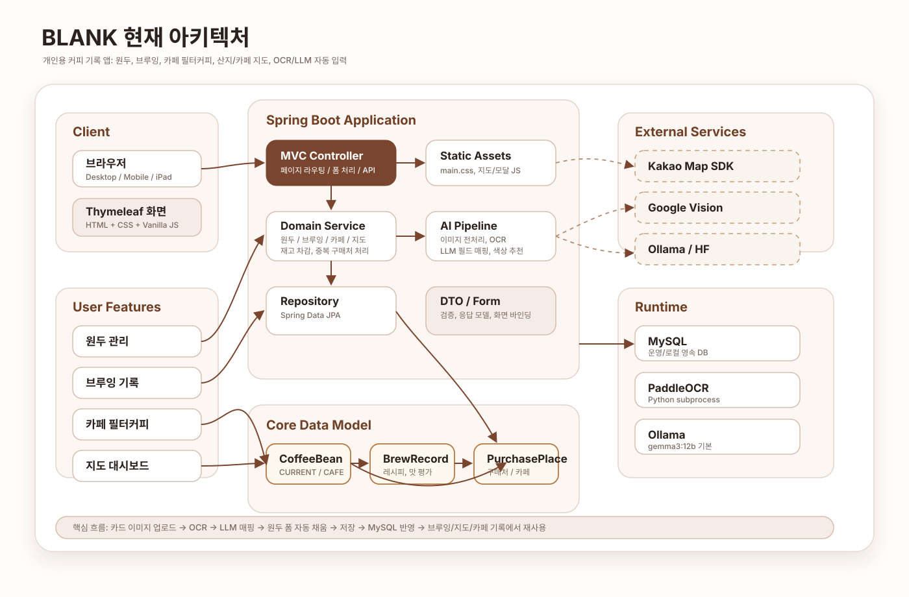
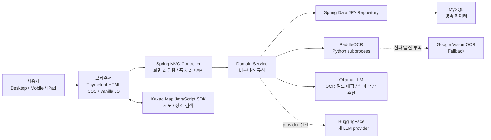

# BrewLog 아키텍처/기능 정리 v1

## 1. 현재 아키텍처

BrewLog는 **Spring Boot MVC + Thymeleaf 기반의 서버 렌더링 웹 앱**입니다. 브라우저는 Thymeleaf 화면과 정적 JavaScript/CSS를 받아 동작하고, 서버는 컨트롤러/서비스/JPA 레이어를 통해 MySQL에 데이터를 저장합니다.

핵심 데이터 모델은 `PurchasePlace -> CoffeeBean -> BrewRecord`입니다. 카페 필터커피는 별도 엔티티가 아니라, `CoffeeBeanStatus.CAFE` 상태의 원두와 `BrewRecord`를 조합해 표현합니다.

## 2. 기술 스택

| 영역 | 사용 기술 |
| --- | --- |
| Language | Java 21 |
| Framework | Spring Boot 4.0.6 |
| View | Thymeleaf, HTML |
| Frontend Script | Vanilla JavaScript |
| Styling | CSS, 반응형 레이아웃 |
| Persistence | Spring Data JPA, Hibernate |
| Database | MySQL |
| Test DB | H2 |
| Validation | Bean Validation |
| Build | Gradle |
| Utility | Lombok |
| Map | Kakao Map JavaScript SDK, Kakao Places |
| Local OCR | PaddleOCR via Python subprocess |
| OCR Fallback | Google Cloud Vision |
| LLM 기본값 | Ollama `gemma3:12b` |
| LLM 대체 구현 | HuggingFace provider |
| Image Handling | Openize HEIC, JPG/PNG/WEBP/HEIC/HEIF 업로드 |
| Data Assets | SCA Flavor Wheel CSV, 한국 행정구역 TopoJSON, 세계 지도 데이터 |

## 3. 주요 도메인

| 도메인 | 역할 |
| --- | --- |
| `coffeeBean` | 원두 등록/수정/삭제, 상태 관리, 향미 노트, OCR 자동 입력 |
| `brewRecord` | 브루잉 기록, 재고 차감/복원, 푸어링 그래프, 맛 레이더 차트 |
| `cafeFilterCoffee` | 카페에서 마신 필터커피 기록, 카페별 필터링, 선택적 레시피 기록 |
| `purchasePlace` | 구매처/카페 저장, 카카오맵 기반 장소 정보, 중복 구매처 재사용 |
| `cafeMap` | 방문 카페 지도, 기록 마커, 현재 지도 화면 안의 카페 검색 |
| `originMap` | 원두 산지 세계 지도, 국가별 경험 원두/브루잉 통계 |
| `llmparsing` | OCR 텍스트 전처리, LLM 프롬프트, JSON 필드 매핑 |

## 4. 사용자 플로우

### 원두 등록 플로우

1. 사용자가 `새 원두`를 누른다.
2. 원두 카드 이미지를 업로드하거나 직접 입력한다.
3. 이미지 업로드 시 서버가 OCR을 실행한다.
4. OCR 텍스트를 LLM이 원두명, 로스터리, 산지, 가공방식, 향미 노트 등으로 매핑한다.
5. 사용자는 자동 입력된 후보값을 확인하고 수정한다.
6. 구매처는 기존 구매처 선택, 카카오 장소 검색, 지도 클릭 중 하나로 채운다.
7. 저장 시 원두, 구매처, 사용자 정의 향미 노트가 MySQL에 저장된다.

### 브루잉 기록 플로우

1. 사용자가 브루잉 기록을 시작한다.
2. 보유 원두를 선택한다.
3. 추출 타입, 원두량, 물량, 물 온도, 분쇄도, 종료 시간을 입력한다.
4. 푸어링 단계는 그래프/입력값으로 조정한다.
5. 만족도, 6축 맛 평가, 느낌 태그, 메모를 남긴다.
6. 저장 시 브루잉 기록이 생성되고, 보유 원두라면 사용량만큼 재고가 차감된다.
7. 수정/삭제 시 기존 차감량을 복원한 뒤 변경값을 다시 반영한다.

### 카페 필터커피 기록 플로우

1. 사용자가 카페 필터 기록을 누른다.
2. 카페를 카카오 장소 검색 또는 지도 클릭으로 선택한다.
3. 마신 원두 정보와 HOT/ICE, 만족도, 향미/느낌을 기록한다.
4. 레시피는 필요할 때만 서브 기능으로 입력한다.
5. 저장된 기록은 카페별 필터링, 카페 지도, 상세 레이더 차트에서 재사용된다.

### 지도 탐색 플로우

1. 홈에서는 경험한 산지를 세계 지도에서 본다.
2. 국가를 클릭하면 해당 국가의 원두/브루잉 요약을 본다.
3. 카페 지도에서는 방문 카페 마커를 카카오맵 위에서 본다.
4. 마커나 목록을 선택하면 카페 정보가 표시된다.
5. 현재 지도 화면 안에서 주변 카페를 검색해 임시 핀으로 확인한다.

## 5. 핵심 기능

| 기능 | 설명 |
| --- | --- |
| 원두 재고 관리 | 보유 중/소진/카페 음용 상태를 나누고, 브루잉 기록과 재고 차감을 연결 |
| OCR 자동 입력 | 원두 카드 이미지를 OCR로 읽고 LLM으로 필드 매핑 |
| 로컬 우선 AI | PaddleOCR, Ollama를 기본으로 사용하고 필요 시 Google Vision/HuggingFace로 대체 가능 |
| 향미 노트 시스템 | 고정 향미 노트 + 사용자 정의 향미 노트, LLM 기반 색상 추천 |
| 브루잉 그래프 | 푸어링 시간을 x축, 누적 물량을 y축으로 부드러운 곡선 그래프 제공 |
| 맛 레이더 차트 | 산미, 단맛, 쓴맛, 바디감, 향, 밸런스 6축 시각화 |
| 카페 필터커피 분리 | 집 브루잉 기록과 카페 음용 기록을 UX상 분리 |
| 구매처/카페 중복 방지 | URL, 좌표, 이름+주소 기준으로 기존 장소를 재사용 |
| 카카오맵 연동 | 구매처/카페 등록, 방문 카페 지도, 현재 지도 범위 카페 검색 |
| 반응형 앱형 UI | 모바일/태블릿에서 헤더, 카드, 상세 모달, 지도 화면을 앱처럼 사용 |

## 6. 배포 관점 정리

개인 사용 기준으로 트래픽과 DB 부하는 작고, 비용/성능 병목은 OCR/LLM입니다.

- Java 서버 + MySQL만 보면 작은 EC2로도 충분합니다.
- 안정적인 단일 서버 운영은 4GB RAM급 EC2가 현실적입니다.
- 로컬 OCR까지 서버에서 돌리려면 8GB RAM 이상이 여유롭습니다.
- Ollama LLM을 EC2 CPU에서 상시 실행하는 것은 응답 시간이 길 수 있습니다.
- GPU EC2로 로컬 LLM을 상시 운영하는 방식은 개인용으로 비용 대비 효율이 낮습니다.

따라서 초기 배포는 **Spring Boot + MySQL은 EC2**, **LLM/OCR은 외부 API 또는 집의 로컬 머신 연동** 구조가 가장 현실적입니다.
