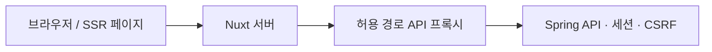

# BLANK · 프론트엔드

**사진 등록부터 결과 확인까지, 입력할 내용이 많아도 복잡하게 느껴지지 않는 화면을 만드는 데 집중했습니다.**

Vue 3 + Nuxt 4 기반의 반응형 SSR 프론트입니다. 기존 Spring 서비스와 DB를 사용하면서, 원두·브루잉·카페 경험의 입력 흐름을 컴포넌트로 구성했습니다.

## 중요하게 생각한 구현

### 1. 입력 부담을 줄이는 단계 설계

원두 생산 정보와 구매 정보를 한 번에 요구하지 않고, AI가 읽은 정보 확인과 선택 정보 입력을 나눴습니다. 현재 단계와 남은 단계를 표시하며 이전 단계로 돌아가도 작성값을 유지합니다.

사진에서 읽은 원두 이름·산지·품종·향미는 수정 가능한 입력값으로 보여줍니다. 구매 날짜와 상태는 사용자 입력을 유지하고, 가격·중량은 선택 정보에서 확인합니다. 브루잉과 카페 경험은 목적에 맞게 별도 흐름으로 구성하며, 카페 경험 폼에는 레시피 입력을 요구하지 않습니다.

핵심 구현: [RecordForm.vue](app/components/RecordForm.vue), [FormField.vue](app/components/FormField.vue), [TemperatureToggle.vue](app/components/TemperatureToggle.vue)

### 2. 기다리는 동안에도 현재 상태가 보이는 AI 입력

사진 분석을 단순한 스피너로만 표현하지 않습니다. 왼쪽에는 선택한 사진, 오른쪽에는 현재 처리 단계를 보여주고 사진 위 스캔 효과로 읽고 있는 대상을 전달합니다.

SSE 이벤트로 OCR·LLM·폼 정리 단계를 받아 표시합니다. 이는 실제 단계 알림이며, 임의의 진행률이나 남은 시간을 확정해서 보여주는 방식은 아닙니다. 오래 걸리거나 실패하면 오류를 표시하고 직접 입력으로 전환할 수 있습니다.

HEIC/HEIF는 서버에서 미리보기용 이미지로 변환하고 그 결과를 분석 요청에도 재사용합니다. 요청 취소와 컴포넌트 종료 시에는 진행 연결과 미리보기 자원을 정리합니다.

핵심 구현: [PhotoExtraction.vue](app/components/PhotoExtraction.vue)

### 3. SSR과 브라우저 전용 기능 분리

Nuxt의 SSR로 페이지의 초기 HTML을 만들고, 카카오 지도와 Three.js 렌더링은 브라우저에서 초기화합니다. 데이터 조회에는 SSR 요청 문맥을 사용할 수 있는 공통 API 함수를 두었습니다.

외부 SDK가 필요한 화면도 전체 앱을 클라이언트 전용으로 바꾸지 않고 구성합니다. 프론트 운영에는 Nuxt Node 서버가 필요하며, 정적 파일만 배포하면 SSR과 API 프록시가 동작하지 않습니다.

핵심 구현: [nuxt.config.ts](nuxt.config.ts), [useBackend.ts](app/composables/useBackend.ts), [useKakao.ts](app/composables/useKakao.ts), [TasteSpace.vue](app/components/TasteSpace.vue)

### 4. 실제 화면을 재사용하는 서비스 설명

홈에서 세계지도를 먼저 보여주고 스크롤로 사진 등록 설명, 시작하기 영역을 이어갑니다. 중간 위치에 애매하게 멈추지 않도록 화면 단위 이동을 구성했습니다.

사진 등록 소개는 영상 대신 실제 사진 입력·폼·상세 컴포넌트를 데모 상태로 재사용합니다. 사진 업로드 → 읽기 → 정리 → 확인 → 수정 → 상세 화면을 시간에 따라 전환해, 영상 압축으로 UI 글자가 흐려지는 문제를 줄였습니다. 실제 기록 저장 요청을 보내는 사용자 동작과 데모 상태는 구분합니다.

화면 밖이거나 탭이 숨겨진 경우 애니메이션 실행을 제어하고, 움직임 줄이기 설정도 반영합니다.

핵심 구현: [PhotoDemo.vue](app/components/PhotoDemo.vue), [useHomePaging.ts](app/composables/useHomePaging.ts)

### 5. 커피 데이터를 시각적으로 읽는 화면

| 표현 | 구현 의도 |
| --- | --- |
| 계층형 향미 휠 | 상위 향미에서 하위 향미를 탐색하고 직접 입력도 허용 |
| 향미 그라데이션 | 원두의 향미 구성을 목록과 상세에서 일관되게 표현 |
| 6축 맛 프로필 | 산미·단맛·쓴맛·바디감·향·밸런스를 함께 비교 |
| 장소 검색과 지도 | 선택한 구매처를 지도에서 확인하고 저장 |
| 3D 취향 공간 | 원두를 점으로 탐색하고 호버로 이름 확인. 향미 색상으로 점 표현 |

향미 휠은 수동 향미 선택을 돕는 UI이며 AI 결과 확인에서는 텍스트로 바로 수정하도록 했습니다. 시각 효과가 실제 입력과 확인을 방해하지 않도록 역할을 나눴습니다.

### 6. 같은 출처의 API·로그인 연결



브라우저는 `/api/backend/*`로 요청하고 Nuxt가 백엔드로 전달합니다. 프록시는 허용한 경로만 통과시키며 임의의 외부 주소를 받지 않습니다. 백엔드 주소는 서버 전용 runtime config에 둡니다.

등록·수정·삭제 전에는 세션 API에서 CSRF 토큰을 가져와 전송합니다. 로그인 시작과 카카오 콜백도 Nuxt 경유 경로를 제공하며, 실제 사용자 인증과 소유자별 접근 확인은 Spring이 담당합니다.

핵심 구현: [API 프록시](server/api/backend/[...path].ts), [로그인 프록시](server/utils/proxyAuth.ts), [공통 API 함수](app/composables/useBackend.ts)

## 반응형과 상태 처리

- 화면 폭에 따라 입력 열 수와 카드·지도 배치를 조정합니다.
- 사진 대기 화면은 데스크톱에서 좌우, 작은 화면에서는 세로로 배치합니다.
- Three.js 영역과 홈 데모는 컨테이너 크기 변화를 반영합니다.
- 공통 오류 표시와 로그인 만료·검증 실패 메시지를 제공합니다.
- 분석 상태는 `role="status"`와 `aria-live`로도 전달합니다.

## 컴포넌트와 폴더 구조

```text
front/
├── app/
│   ├── pages/             # 원두·브루잉·카페·지도 페이지
│   ├── components/        # 입력 폼, AI 처리 화면, 목록·상세, 시각화
│   ├── composables/       # API, 카카오 SDK, 홈 스크롤 제어
│   └── assets/css/        # 기본 스타일과 캔버스 대조 스타일
├── server/
│   ├── api/backend/       # 허용 경로 API 프록시
│   ├── routes/            # 로그인 시작과 OAuth 콜백
│   └── utils/             # 인증 프록시 공통 처리
├── public/                # 이미지·지도 데이터·브라우저 렌더링 자원
└── tests/                 # Playwright 테스트
```

`RecordForm`, `RecordList`, `RecordDetail`을 기록 종류에 따라 재사용하고, 사진 분석·장소 선택·향미 선택처럼 독립적인 상호작용은 별도 컴포넌트로 둡니다.

Vue 템플릿은 기존 HTML 구조를 옮기고 폼을 컴포넌트화하는 데 적합하다고 판단했습니다. 페이지·서버 경로·SSR을 함께 구성하기 위해 Nuxt를 사용합니다.

## 로컬 실행

clone 후 추가할 설정 파일과 외부 서비스 준비는 [최상위 SETUP.md](../SETUP.md)를 참고합니다. 설치된 Nuxt의 지원 범위인 Node.js `^22.22.3 || ^24.15.0 || >=26.0.0`과 npm을 준비합니다.

백엔드를 실행한 다음 `front/`에서 실행합니다.

```bash
cp .env.example .env
npm ci
npm run dev
```

`.env`에는 백엔드 주소만 지정합니다.

```dotenv
NUXT_BACKEND_URL=http://127.0.0.1:8080
```

- 새 프론트: `http://127.0.0.1:3000`
- 백엔드: `http://127.0.0.1:8080`
- Groq 등 외부 AI 키는 백엔드에만 설정합니다.
- 두 UI가 같은 백엔드를 사용하면 같은 DB 기록을 조회·수정합니다.

카카오 콘솔에는 실제 접속 도메인의 지도 SDK 주소와 `/login/oauth2/code/kakao` Redirect URI를 등록합니다. 프록시 운영 환경에서는 신뢰할 수 있는 forwarded 헤더만 Spring에 전달해야 합니다.

## 확인 방법

```bash
npm run typecheck
npm run format:check
npm test
npm run build
```

[Playwright 테스트](tests/frontend.spec.ts)와 실제 브라우저로 폼 이동, 오류 표시, 모바일·데스크톱 배치를 확인합니다. 외부 카카오 로그인·OCR·LLM의 실제 동작은 해당 키가 설정된 환경에서 별도로 확인해야 합니다.

운영 SSR 실행:

```bash
NUXT_BACKEND_URL=http://127.0.0.1:8080 NITRO_PORT=3000 npm start
```

`npm start`는 앞서 생성한 `.output/`의 Node 서버를 실행합니다.

## 관련 문서

- [프로젝트 소개와 목표](../README.md)
- [백엔드 아키텍처·AI 처리](../coffee/README.md)
- [캔버스 대조 기록](docs/CANVAS_REVIEW.md)
